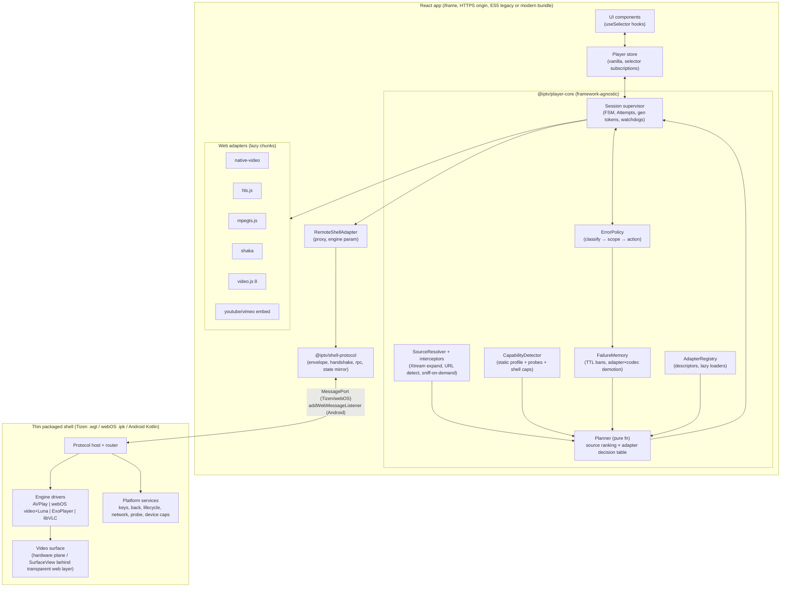
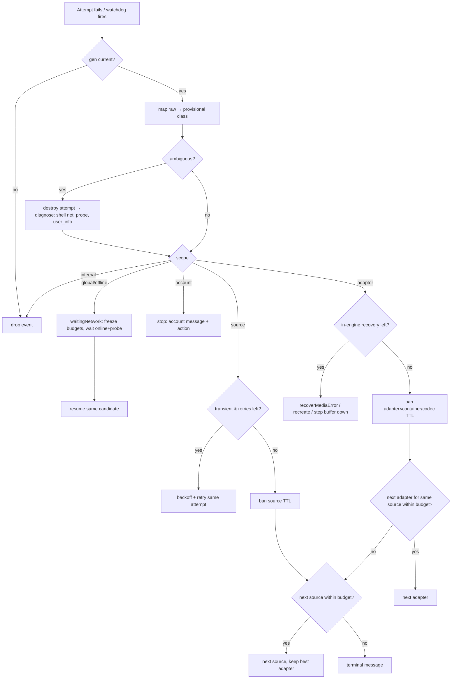
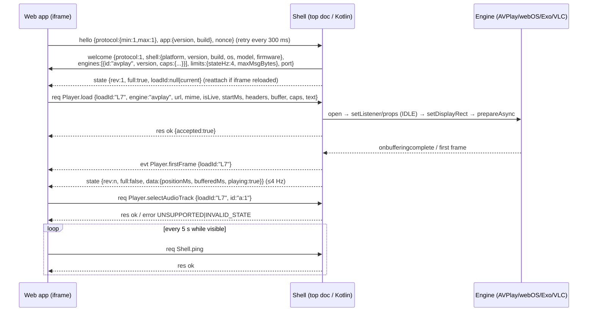

# Build a policy-driven playback microkernel, not a player

**The best architecture is a small, framework-agnostic microkernel with four parts. Adapters are Strategy objects held in a registry and loaded lazily. A pure selection function ranks sources first and adapters second, using an ordered per-platform decision table. A Session/Attempt supervisor runs a hand-rolled finite-state machine. An error policy object decides by scope (global, account, source, adapter) whether to wait, retry, change source or change adapter.** Native players (Tizen AVPlay, webOS `<video>` plus Luna, Media3 ExoPlayer, libVLC) are reached through one generic *remote-proxy adapter*. That adapter speaks a hand-written, JSON-RPC-style protocol over a `MessagePort`, or over `addWebMessageListener` on Android, to a thin "driver" inside each packaged shell. Every element of this design has a precedent in shipping code: Kaltura's priority-walk engine selection, Vidstack's lazy loaders, Stremio's decorator wrappers and shell transport, ExoPlayer's error-policy object, the hls.js penalty box, Shaka's jittered backoff, and media-chrome's selector-based React store. The assembled whole, however, has not been built or validated anywhere, so treat it as an engineering synthesis. Your constraints also produce one consequence you should plan around. Because playback must stay client-side (no relay proxy), typical Xtream sources (plain `http://`, no CORS headers) are reachable **only by native shell players** on TVs and Android. They are not reachable by hls.js, mpegts.js or Shaka running in an HTTPS-hosted iframe, and on desktop web they cannot play at all unless the provider offers HTTPS with CORS. So on TVs the fallback chain for real Xtream traffic is mostly *source* fallback (TS ↔ HLS variants, mirrors) and *native-mode* fallback. Web engines are the second line for HTTPS sources that send CORS headers. Several platform facts, including MessagePort behaviour between a packaged Tizen/webOS page and a remote iframe, Tizen key routing into iframes, and MSE quotas on 2016–2017 TVs, could not be verified from vendor documentation. A device-lab spike is therefore phase zero.

## Your constraints quietly decide most of the design

Four requirements interact more strongly than they first appear. The first is client-only playback. Browsers block `http://` media fetches from HTTPS pages (mixed content). Providers rarely send CORS headers, and MSE engines must `fetch`/XHR every byte, so they need CORS ([Channels DVR thread](https://community.getchannels.com/t/reverse-proxy-and-web-player/38853); [LG CORS FAQ](https://webostv.developer.lge.com/faq/how-to-solve-the-problem-if-cors-occurs)). Amazon's Fire TV WebView goes further and auto-upgrades mixed-content audio and video to HTTPS from v84, which usually fails on IPTV servers ([Fire TV web app FAQ](https://developer.amazon.com/zh/docs/fire-tv/web-app-faq.html)). Native players in a shell are not browsers. AVPlay accepts a `USER_AGENT` and `COOKIE` streaming property ([@types/tizen-tv-webapis](https://www.npmjs.com/package/@types/tizen-tv-webapis)). ExoPlayer only refuses cleartext if the app's Network Security Config forbids it, which surfaces as `IO_CLEARTEXT_NOT_PERMITTED` 2007 ([PlaybackException](https://developer.android.com/reference/androidx/media3/common/PlaybackException)). Neither enforces CORS. Native adapters are therefore the *primary* path on every shell platform. Web engines in the iframe are a secondary path for HTTPS/CORS sources and embeds.

The second requirement is your rule that CORS and mixed content are **source-level** errors that must not switch adapters. It is compatible with the above if the planner applies those constraints *before* playback. Mixed content can be predicted from URL schemes alone. A known "no-CORS host" can be learned once and remembered. So the planner simply never proposes an MSE adapter for such a source. That is selection, not reactive switching. When a CORS failure does surface at runtime, the policy moves to the next *source*, as you require.

The third requirement is the old engines: Chromium 38 on webOS 3.0/3.2, 47 on Tizen 3, and 53/56 on webOS 4 and Tizen 4 ([signageOS engine table](https://developers.signageos.io/devices/device-guides/general-information/browser-webkit-and-chromium-versions-by-each-platform); [webOSBrew](https://www.webosbrew.org/develop/guides/web-app/web-engine)). These rule out Video.js 10 (Chrome 111+, ES2022) ([Video.js 10 browser support](https://videojs.org/docs/framework/html/guides/browser-support)), Comlink (needs `Proxy`, Chrome 49) ([Comlink](https://github.com/GoogleChromeLabs/comlink)), and any library shipped with untranspiled modern syntax. They push the design toward hand-rolled, small, ES5-compiled code.

The fourth requirement is that low-spec performance comes first. That means one engine at a time, never two decoders, and adapters loaded on demand. Media buffers should stay in native pipelines wherever possible. Tizen kills web apps under memory pressure without warning, and webOS restarts apps "to free up more memory" after long high-bitrate sessions ([floatleft Tizen guide](https://floatleftinteractive-project.pages.dev/samsung-tv-app-development); [Plex forum](https://forums.plex.tv/t/lgwebos-plex-app-dies-with-message-app-will-now-restart-to-free-up-more-memory-streaming-hdr/891018)).

## Twelve design decisions, each chosen against named alternatives

The table compresses the pattern comparison. Each choice is argued from what mature players do, which the research team read in source code rather than blog posts.

| Concern | Alternatives considered | Chosen | Why |
|---|---|---|---|
| Adapter abstraction | (a) wrap one "universal" player (Video.js 8 techs, Video.js 10 media elements, Shaka for everything); (b) inheritance hierarchy (Template Method); (c) own interface + **Strategy** per engine | (c), with Video.js and Shaka as adapters | Video.js 10 needs Chrome 111. Video.js 8 ships ES2015 syntax and owns/disposes the element. Shaka cannot drive AVPlay or ExoPlayer. Stremio, playkit, Vidstack and Jellyfin all converge on a per-engine Strategy with a shared contract ([stremio-video](https://github.com/stremio/stremio-video/blob/master/src/StremioVideo/selectVideoImplementation.js); [playkit-js](https://github.com/kaltura/playkit-js/blob/master/src/player.ts)) |
| Adapter creation | Abstract Factory; Service Locator; **Registry (microkernel) + lazy loader** | Registry of descriptors with `canPlay()` + `load(): Promise<Factory>` | Vidstack's `MediaProviderLoader` exposes `canPlay(src)` and `load(ctx): Promise<Provider>`, and react-player 3 lazy-imports each provider ([Vidstack types.ts](https://github.com/vidstack/player/blob/main/packages/vidstack/src/providers/types.ts); [react-player players.ts](https://raw.githubusercontent.com/cookpete/react-player/master/src/players.ts)). Abstract Factory adds nothing that the registry entry does not already do |
| Adapter choice | if-ladder per platform (Stremio); Chain of Responsibility "first that can play" (Video.js, Vidstack); weighted scoring; rules engine | **Ordered decision table** keyed by platform × media kind, filtered by a tri-state `canPlay` verdict, demoted by failure memory | Video.js 8 takes the *first* handler that says `maybe` or `probably`, and a TODO in its source asks whether `probably` should win ([tech.js](https://github.com/videojs/video.js/blob/8.x/src/js/tech/tech.js)). Playkit walks a configurable `streamPriority` list. None of the surveyed web players scores adapters. A table is deterministic, configurable and unit-testable. Scoring is reserved for *sources* |
| Cross-cutting behaviour (sidecar subtitles, URL rewrite, headers, Xtream variants) | subclassing; middleware pipeline; **Decorator** around adapters + **interceptor chain** around source resolution | Both | Stremio composes `withStreamingServer(withHTMLSubtitles(TizenVideo))`, and playkit wraps engines in `EngineDecorator`s. Shaka chains request/response filters ([stremio-video](https://github.com/stremio/stremio-video/blob/master/src/StremioVideo/selectVideoImplementation.js); [Shaka networking_engine.js](https://github.com/shaka-project/shaka-player/blob/main/lib/net/networking_engine.js)) |
| Lifecycle | XState v5 (~11.8 KB gz, needs Babel for Chrome 38); `@xstate/fsm` (~2.0 KB gz, transpiles as shipped); robot3 (~1 KB, needs Babel); **hand-rolled transition table** | Hand-rolled table (≈0.5–1 KB), with `@xstate/fsm` acceptable | Sizes were measured by the research team with esbuild on the npm packages. No surveyed player uses a statechart library at its core, and hierarchical or parallel states are unnecessary |
| Concurrency on zapping | flags (`isChangingStream`, Jellyfin); command queue; **generation token + AbortController** | Session → Attempt with `gen`, latest-wins `load`, serialised track/seek commands | This generalises Jellyfin's guard and Vidstack/Shaka abort plumbing ([playbackmanager.js](https://github.com/jellyfin/jellyfin-web/blob/master/src/components/playback/playbackmanager.js); [Shaka backoff.js](https://github.com/shaka-project/shaka-player/blob/main/lib/net/backoff.js)) |
| Resilience | ad-hoc try/catch; **policy object** (classify → decide); circuit breaker; bulkhead; hedged requests | Policy object + TTL "penalty box" bans for sources and adapter×codec pairs + jittered capped backoff | ExoPlayer's `DefaultLoadErrorHandlingPolicy` maps errors to retry, exclude-and-fallback or fail. hls.js has `SendAlternateToPenaltyBox`. Shaka bans locations for 60 s ([ExoPlayer policy](https://github.com/androidx/media/blob/release/libraries/exoplayer/src/main/java/androidx/media3/exoplayer/upstream/DefaultLoadErrorHandlingPolicy.java); [hls.js error-controller](https://github.com/video-dev/hls.js/blob/master/src/controller/error-controller.ts); [Shaka content steering](https://github.com/shaka-project/shaka-player/blob/main/lib/util/content_steering_manager.js)). A bulkhead appears in no player. Hedging would double decoders and Xtream connection slots |
| State propagation | React context/state; Redux; **Observer + tiny external store with selectors** | Vanilla store + `useSyncExternalStore` selector hooks | This is media-chrome's `useMediaSelector` design ([media-chrome](https://www.npmjs.com/package/media-chrome)). It keeps `timeupdate` out of React's render path |
| Native bridge | Comlink; Penpal 8; birpc; post-robot/zoid; postmate; **hand-rolled JSON-RPC-style protocol** | Hand-rolled (≈300–500 lines per side) | Comlink needs Proxy. Penpal 8 ships optional chaining (Chrome 80). birpc needs transpiling. post-robot and zoid are heavy, and postmate's last release was 2019. None of them maps onto a Kotlin peer ([Penpal](https://github.com/Aaronius/penpal); [birpc](https://github.com/antfu-collective/birpc)) |
| Native adapter shape | one web adapter class per native engine; **one Remote Proxy adapter parameterised by engine** + per-engine *drivers* in the shell | Remote Proxy | Engine-specific quirks then stay next to the engine, in Kotlin or shell JS. The web side sees capability flags only. This is Stremio's `ShellVideo` idea of an injected `shellTransport` ([ShellVideo.js](https://github.com/Stremio/stremio-video/blob/master/src/ShellVideo/ShellVideo.js)) |
| React integration | component owns player (react-player style); **headless core + hooks** | Headless | The core must survive iframe reloads and run in tests without React. The Video.js 10 and media-chrome stores take the same headless approach ([Video.js 10 architecture](https://v10.videojs.org/docs/framework/html/style/css/concepts/architecture)) |
| Packaging | in-app folder; separately published library; **internal monorepo packages with a stable public API** | Monorepo packages, publish later if useful | This keeps one version line across web, protocol and shells while enforcing layering (see packaging section) |

Weighted scoring for adapters deserves a steelman, because it looks more "intelligent". Its weakness is that scores interact non-obviously. A 0.1 weight change can reorder chains on one TV model and nobody notices until field reports arrive. The table-plus-verdict-plus-memory design gives the same adaptivity in a form that is explainable ("AVPlay was demoted because it failed HEVC-in-MKV on this firmware 3 times in 7 days") and that can be overridden per platform in config. Scoring is still the right tool for *sources*, because sources are many, similar, and differ along continuous dimensions such as resolution, bitrate, region and past success rate. ExoPlayer's track selector, Shaka ABR and Jellyfin's server-side DeviceProfile negotiation all score one level below the engine ([Jellyfin playbackmanager.js](https://github.com/jellyfin/jellyfin-web/blob/master/src/components/playback/playbackmanager.js)).

## A microkernel core, lazy adapters and one remote proxy per shell

The architecture has three runtime tiers. The first is the React app inside the iframe, holding the core, the web adapters and the remote proxy. The second is a transport. The third is a thin shell that owns the platform: AVPlay, the webOS `<video>` and Luna, ExoPlayer/libVLC, keys, lifecycle and network status. On desktop the shell tier is absent, and the remote proxy is simply not registered.



The data flow for a single "play" intent runs like this. The UI calls `player.play(item, {manual?})`, and the supervisor opens a **Session**. The resolver expands the item's sources: an Xtream live stream becomes `.ts` and `.m3u8` candidates per `allowed_output_formats`, an embed URL becomes an embed source, and an M3U entry becomes a direct URL. The planner returns a lazy iterator of `(source, adapter)` candidates. The supervisor starts an **Attempt** for the head candidate. It loads the adapter chunk or confirms the shell engine, tears down the previous attempt completely, then calls `load()` with an AbortSignal and a time-to-first-frame watchdog. Adapter events are normalised into `PlaybackError` records. The policy then decides among *wait* (offline), *retry same attempt*, *next source*, *next adapter*, or *stop with message*. Each decision updates failure memory, and the next attempt is drawn from the same iterator. The planner is a pure function, so a test can replay any field incident from a log of `(env, item, memory)`.

The shell side mirrors this split. The shell does not decide anything. It executes commands, reports normalised state and raw native error codes, and owns the things only it can reach: platform keys, Back, app lifecycle, network status, a device-capability report and an optional `probe` of a URL. That keeps shells small enough to change rarely, which matters because installed shells update slowly while the web app deploys continuously. Stremio's web player still carries a fallback heuristic for "older shells" that lack its ready event, which is real-world evidence that this kind of version skew happens ([ShellVideo.js](https://github.com/Stremio/stremio-video/blob/master/src/ShellVideo/ShellVideo.js)).

## Interfaces: one adapter contract, declared capabilities, sessions of attempts

The sketches below are the contract the rest of the report relies on. They are written to compile to ES5. They use no `Proxy`, no `Symbol`-dependent iteration in hot paths, and `Map` only where Chromium 38 has it (Chrome 38 per [MDN browser-compat-data](https://github.com/mdn/browser-compat-data)).

```ts
// ---------- environment & media model ----------
export type PlatformId = 'desktop-web' | 'tizen' | 'webos' | 'android' | 'android-tv';
export interface Env {
  platform: PlatformId;
  platformVersion?: string;          // Tizen "3.0", webOS from shell (UA is unreliable on webOS)
  chromium: number;                  // 38, 47, 53, 56, ...
  pageScheme: 'https' | 'http' | 'file';
  shell?: ShellInfo;                 // from handshake: engines, caps, versions
  device: { model?: string; firmware?: string; ramMb?: number; uhdPanel?: boolean };
  network: { online: boolean; type?: 'ethernet' | 'wifi' | 'cellular' };
}

export type MediaKind = 'live' | 'vod' | 'episode' | 'catchup' | 'embed';
export type Container = 'hls' | 'dash' | 'ts' | 'mp4' | 'mkv' | 'webm' | 'avi' | 'flv' | 'unknown';

export interface Source {
  id: string;
  url: string;                                   // contains credentials for Xtream: never log raw
  container: Container;
  containerEvidence: 'declared' | 'xtream-ext' | 'extension' | 'sniffed' | 'guess';
  codecs?: { video?: string; audio?: string[] }; // from Xtream info / probe / memory
  variant?: { height?: number; bitrate?: number; region?: string; label?: string; lang?: string };
  origin: { kind: 'xtream' | 'm3u' | 'direct' | 'embed'; host: string; accountKey?: string;
            xtream?: { type: 'live' | 'movie' | 'series'; streamId: string; ext: string } };
  embed?: { provider: 'youtube' | 'vimeo' | 'twitch' | 'dailymotion'; id: string; hash?: string };
  headers?: { userAgent?: string; referer?: string; cookie?: string }; // honoured by native drivers only
  sidecarText?: Array<{ url: string; lang?: string; format: 'vtt' | 'srt' | 'ttml' | 'ass' }>;
  authorPriority?: number;                       // playlist order / provider preference
}

export interface MediaItem {
  id: string; kind: MediaKind; title: string;
  sources: Source[];                             // >= 1; resolver may expand
  startPositionMs?: number;
  memoryKeys: { channel?: string; category?: string };  // for per-channel/category pins
}

// ---------- capabilities ----------
export type Verdict = 'probably' | 'maybe' | 'no';
export type ScaleMode = 'fit' | 'fill' | 'zoom' | 'stretch' | 'original' | { ratio: string };

export interface AdapterCapabilities {
  needsCors: boolean;            // MSE engines: true; native/shell: false
  mixedContentSafe: boolean;     // can play http:// from an https page
  customHeaders: ('userAgent' | 'referer' | 'cookie')[];
  audioTracks: 'select' | 'list' | 'none';
  text: { embedded: 'select' | 'none'; sidecar: Array<'vtt' | 'srt' | 'ttml' | 'ass'>;
          rendering: 'engine' | 'cues-to-web' | 'native-styled'; styling: boolean };
  quality: 'select' | 'cap' | 'none';
  rates: number[] | 'continuous' | 'none';
  scaleModes: ScaleMode[];
  live: { seekToLive: boolean; dvrWindow: boolean; latencyControl: boolean };
  buffer: { forwardSec: boolean; backSec: boolean; bytes: boolean; preStartOnly?: boolean };
  errorDetail: { httpStatus: boolean; nativeCodes: boolean };
  surface: 'video-element' | 'hardware-plane' | 'iframe';
}

// ---------- adapters ----------
export type AdapterId = 'native-video' | 'hlsjs' | 'mpegts' | 'shaka' | 'videojs8'
  | 'youtube' | 'vimeo' | 'shell:avplay' | 'shell:webos-video' | 'shell:exoplayer' | 'shell:libvlc' | string;

export interface AdapterDescriptor {
  id: AdapterId;
  family: 'mse' | 'native-element' | 'shell' | 'embed';
  platforms: PlatformId[];
  canPlay(src: Source, env: Env): { verdict: Verdict; reasons: string[] };  // pure, sync, cheap
  staticCaps(env: Env): AdapterCapabilities;
  load(env: Env): Promise<AdapterFactory>;       // dynamic import(), or shell engine confirmation
  preload?(env: Env): void;                      // idle-time chunk warmup
}
export type AdapterFactory = (ctx: AdapterContext) => PlaybackAdapter;

export interface AdapterContext {
  surface: Surface;                    // shared <video> host / hardware-plane rect / embed container
  bufferProfile: BufferProfile;
  emit(e: AdapterEvent): void;         // to supervisor (tagged with attempt gen by the supervisor)
  log(msg: string, data?: object): void;
}

export type CmdResult = { ok: true } | { ok: false; reason: 'unsupported' | 'invalid-state' | 'failed'; detail?: string };

export interface PlaybackAdapter {
  readonly id: AdapterId;
  load(req: LoadRequest, signal: AbortSignalLike): Promise<void>;  // resolves at first frame (or canplay)
  play(): Promise<CmdResult>;
  pause(): CmdResult;
  seek(positionMs: number): Promise<CmdResult>;
  seekToLive?(): Promise<CmdResult>;
  setRate?(rate: number): CmdResult;
  setVolume(v: number): CmdResult;
  setMuted(m: boolean): CmdResult;
  getTracks(): { audio: Track[]; text: Track[]; video: Track[] };
  selectAudio?(id: string): Promise<CmdResult>;
  selectText?(id: string | null): Promise<CmdResult>;
  addSidecarText?(t: NonNullable<Source['sidecarText']>[number]): Promise<CmdResult>;
  getQualities?(): Quality[];
  selectQuality?(id: string | 'auto'): CmdResult;
  capQuality?(maxHeight: number, maxBitrate?: number): CmdResult;
  setScaleMode?(m: ScaleMode): CmdResult;
  setBufferProfile?(p: BufferProfile): CmdResult;
  getStats?(): PlaybackStats;
  runtimeCaps(): Partial<AdapterCapabilities>;   // refined after load (Vidstack "supported" flags)
  destroy(): Promise<void>;                      // MUST release decoder, MediaSource, sockets
}

export interface LoadRequest {
  source: Source; startPositionMs?: number; isLive: boolean;
  preferredAudioLang?: string; preferredTextLang?: string | null;
  maxHeight?: number; maxBitrate?: number;
}

export type AdapterEvent =
  | { t: 'state'; patch: Partial<PlaybackState> }         // coalesced by adapter
  | { t: 'firstFrame' } | { t: 'buffering'; on: boolean; percent?: number }
  | { t: 'tracks' } | { t: 'quality'; id: string; bitrate?: number; height?: number }
  | { t: 'cue'; text: string | null; startMs?: number; endMs?: number }   // for HTML-rendered subs
  | { t: 'ended' } | { t: 'error'; error: RawEngineError };

// ---------- sessions & attempts ----------
export type SessionState = 'idle' | 'planning' | 'loading' | 'playing' | 'paused' | 'buffering'
  | 'waitingNetwork' | 'recovering' | 'failed' | 'ended';

export interface Attempt {
  gen: number;                    // monotonically increasing; stale events are dropped
  source: Source; adapterId: AdapterId;
  startedAt: number; firstFrameAt?: number;
  retriesUsed: number; abort: AbortControllerLike;
  outcome?: 'ok' | ErrorClass;
}
export interface Session {
  id: string; item: MediaItem; mode: 'auto' | 'manual';
  pin?: { adapterId?: AdapterId; sourceId?: string; scope: 'session' | 'channel' | 'category' };
  attempts: Attempt[]; state: SessionState;
  budget: { adapterSwitches: number; sourceSwitches: number; deadlineAt: number };
}

// ---------- errors ----------
export type ErrorScope = 'global' | 'account' | 'source' | 'adapter' | 'internal';
export type ErrorClass =
  | 'offline' | 'timeout' | 'host_unreachable' | 'cors' | 'mixed_content' | 'cleartext_blocked'
  | 'auth' | 'account_expired' | 'account_disabled' | 'too_many_connections' | 'forbidden_geo_ip'
  | 'not_found' | 'upstream' | 'redirect' | 'invalid_content' | 'stall' | 'behind_live'
  | 'container_unsupported' | 'codec_unsupported' | 'decode' | 'quota_exceeded' | 'drm'
  | 'embed_blocked' | 'embed_client_id' | 'embed_bad_param' | 'embed_player'
  | 'adapter_crash' | 'shell_unavailable' | 'aborted' | 'unknown';

export interface RawEngineError {
  engine: AdapterId; fatal: boolean;
  layer: 'network' | 'manifest' | 'media' | 'drm' | 'embed' | 'internal';
  httpStatus?: number; code?: string | number; name?: string; detail?: string; url?: string; raw?: unknown;
}
export interface PlaybackError {
  cls: ErrorClass; scope: ErrorScope; i18nKey: string; params?: Record<string, string | number>;
  raw: RawEngineError; diagnosis?: 'probe' | 'user_info' | 'heuristic';
}

// ---------- policy configuration ----------
export interface PolicyConfig {
  chains: Record<PlatformId, Partial<Record<'hls' | 'ts-live' | 'progressive' | 'mkv' | 'dash' | 'embed', AdapterId[]>>>;
  sourceRanking: { weights: { authorPriority: number; formatAffinity: number; resolutionFit: number;
                              history: number; region: number }; preferFormat?: Partial<Record<PlatformId, ('ts' | 'm3u8')[]>> };
  retry: { sameAttemptMax: number; baseDelayMs: number; factor: number; jitter: number; maxDelayMs: number };
  budgets: { maxAdapterSwitches: number; maxSourceSwitches: number; sessionDeadlineMs: number };
  watchdogs: { ttffLiveMs: number; ttffVodMs: number; stallMs: number };
  bans: { sourceTtlMs: number; adapterCodecTtlMs: number; noCorsHostTtlMs: number };
  tooManyConnections: { autoRetryOnceAfterMs: number | null };
  offline: { probeIntervalMs: number; maxProbeIntervalMs: number };
  manual: { onAdapterError: 'stop-and-offer-auto' | 'fall-through-to-auto' };
  bufferProfiles: Record<'tv-low' | 'tv-std' | 'mobile' | 'desktop', BufferProfile>;
}
export interface BufferProfile { forwardSec: number; backSec: number; maxBytes: number; startLevel?: 'low' | 'mid' | 'last' }
```

Three properties of this contract do most of the work. `canPlay` is synchronous and side-effect-free, so planning never touches the network. Commands return `{ok:false, reason:'unsupported'}` instead of throwing, so the UI can grey out a feature without knowing which engine is active. And `destroy()` is the only way to end an attempt. That makes "release decoder and Xtream connection slot before the next attempt" a contract obligation, not a hope.

## The capability matrix shows where engines really differ

The matrix maps each engine to the unified interface. "Orchestrator" means the core supplies the feature generically. Examples are CSS-based scale modes for any `<video>`-surface adapter, and an HTML subtitle renderer fed by `cue` events or sidecar parsing (Stremio's `withHTMLSubtitles` precedent). Cells marked † are prior knowledge or inference that was not re-verified in this research.

| Unified feature | native `<video>` (Chromium desktop) | hls.js 1.7 | Shaka 5.3 | mpegts.js 1.8 | Video.js 8 + VHS | Tizen AVPlay (shell) | webOS `<video>` + Luna (shell) | Media3 ExoPlayer 1.11 (shell) | libVLC 3.6 (shell) | YouTube / Vimeo embed |
|---|---|---|---|---|---|---|---|---|---|---|
| Containers / protocols | MP4, WebM; Matroska partly | HLS (TS, fMP4) | DASH, HLS, MSS; TS transmuxed | raw TS, M2TS, FLV over HTTP/WS; **no seeking** | HLS, DASH | MP4, MKV, TS, HLS, DASH, others (version-dependent) | MP4, TS, MKV, native HLS (≥3.5), DASH | HLS, DASH, SS, RTSP, MP4, MKV, TS, PS, FLV (not seekable) | nearly any, plus multicast, RTMP† | provider-hosted |
| Needs CORS / mixed-content safe | no for progressive†; mixed blocked or upgraded | **yes / no** | **yes / no** | **yes / no** | **yes / no** | no / yes | no / yes | no / yes (cleartext must be allowed) | no / yes | n/a |
| Custom UA / Referer / Cookie | no | no (browser forbids) | no | `headers` config (non-forbidden only) | no | `USER_AGENT`, `COOKIE` (IDLE only) | no public API found | yes (DataSource factory)† | yes (`:http-user-agent`, `:http-referrer`)† | no |
| Audio track select | **no** (flagged in Chromium) | yes (`audioTrack`) | yes (`selectAudioTrack`) | **no** | yes (`audioTracks()`) | yes (`setSelectTrack('AUDIO')`; defer while paused) | Luna `selectTrack{type:'audio'}`; `audioTracks` ≥4.0 | yes (track overrides)† | yes (`setAudioTrack`)† | Vimeo `selectAudioTrack`; YouTube none |
| Embedded text select | `textTracks` (in-band limited) | VTT, IMSC1, CEA-608/708 | VTT, TTML, 608/708, SRT, SSA | **none** (raw PGS/ARIB events) | VTT, 608/708 | embedded via `onsubtitlechange` → **HTML render** | Luna `setSubtitleEnable` + `selectTrack{type:'text'}` | VTT, TTML, SSA (limited style), PGS/DVB† | SPU + libass† | Vimeo `enableTextTrack`; YouTube unreliable† |
| Sidecar subtitles | `<track>` VTT | no SRT/ASS parser | `addTextTrackAsync` (VTT/SRT/TTML…) | orchestrator | VTT via `addRemoteTextTrack`† | **local path only** (`setExternalSubtitlePath`) → orchestrator HTML | orchestrator HTML† | `SubtitleConfiguration` VTT/TTML/SRT/SSA | `addSlave`† | n/a |
| Subtitle styling | CSS `::cue` | CSS / custom | TextDisplayer | orchestrator | CSS | orchestrator | Luna colours, size 0–4, position −3…4 | `CaptionStyleCompat`† | libass† | provider |
| Playback rate | continuous | via element | via element | via element (VOD only meaningful) | continuous | **discrete** −16…16 (HTTP −8…8) | Luna `setPlayRate` | continuous | continuous† | YouTube set list; Vimeo 0–2 (paid) |
| Scale / aspect | orchestrator (CSS `object-fit`/transform†) | orchestrator | orchestrator | orchestrator | orchestrator | `setDisplayMethod` letter-box / full / auto-aspect; `setDisplayRect` 1920×1080 space | CSS on shell element† | resize modes FIT/FILL/ZOOM† | `setAspectRatio`, `setVideoScale`† | none |
| Quality | none | select + cap (`currentLevel`, `autoLevelCapping`) | select + cap (`selectVariantTrack`, restrictions) | none | select (`qualityLevels()`) | **cap only, pre-start** (`ADAPTIVE_INFO` BITRATES / `FIXED_MAX_RESOLUTION`); read `AVAILABLE_BITRATE` | none found | select + cap (`setMaxVideoSize`)† | none for HLS† | Vimeo `setQuality` (paid); YouTube no-op† |
| Live | element `seekable` | `liveSyncPosition`, latency, target latency | `goToLive`, `seekRange` | latency chasing (`liveSync`) | `liveTracker`† | `IS_LIVE`, `GET_LIVE_DURATION`; DVR range | native | `LiveConfiguration`; `BEHIND_LIVE_WINDOW` 1002 | basic† | YouTube live; Twitch no seek |
| Buffer control | none | forward/back/bytes | goal / behind / eviction | stash, `autoCleanupSourceBuffer` | global VHS constants | `setBufferingParam` (IDLE only, seconds ≥4), `setTimeoutForBuffering` | none found (mediaOption unverified) | `DefaultLoadControl`† | `network-caching`† | none |
| Error detail | `MediaError` 1–4 + message | type/details/fatal + `response.code` | category/code/severity + HTTP status | type/detail + HTTP code; no fatal flag | MediaError 0–5 | `PLAYER_ERROR_*` strings + `PLAYER_MSG_HTTP_ERROR_CODE` event | `MediaError` only | stable int codes + HTTP status | bare `EncounteredError`† | YouTube numeric; Vimeo named |
| Old-engine fit | n/a | UMD ES5, Chrome 47+ | ES5 build; Tizen 2017 tested; webOS community | ES5 UMD, no stated minimum | **ES2015 dist** (needs Babel <49) | Tizen 2.3+ API; Tizen 4/5 deprecations | webOS 3 lacks `audioTracks`; HLS needs ≥3.5 | minSdk per Media3 | per ABI ~18–30 MB† | needs https Referer |

Sources for the matrix: [hls.js API.md](https://github.com/video-dev/hls.js/blob/master/docs/API.md), [hls.js README](https://github.com/video-dev/hls.js/blob/master/README.md), [Shaka player.js](https://github.com/shaka-project/shaka-player/blob/main/lib/player.js), [Shaka README](https://github.com/shaka-project/shaka-player/blob/main/README.md), [mpegts.js api.md](https://github.com/xqq/mpegts.js/blob/master/docs/api.md), [mpegts.js README](https://github.com/xqq/mpegts.js/blob/master/README.md), [VHS README](https://github.com/videojs/http-streaming/blob/main/README.md), [MDN BCD HTMLMediaElement](https://github.com/mdn/browser-compat-data/blob/main/api/HTMLMediaElement.json), [AVPlay typings](https://www.npmjs.com/package/@types/tizen-tv-webapis), [Stremio TizenVideo](https://raw.githubusercontent.com/Stremio/stremio-video/master/src/TizenVideo/TizenVideo.js), [Stremio WebOsVideo](https://raw.githubusercontent.com/Stremio/stremio-video/master/src/WebOsVideo/WebOsVideo.js), [Jellyfin device profile](https://raw.githubusercontent.com/jellyfin/jellyfin-web/master/src/scripts/browserDeviceProfile.js), [Media3 supported formats](https://developer.android.com/media/media3/exoplayer/supported-formats), [Media3 releases](https://developer.android.com/jetpack/androidx/releases/media3), [vimeo/player.js](https://github.com/vimeo/player.js/blob/master/README.md), [VideoLAN forum on SDK size](https://forum.videolan.org/viewtopic.php?p=499327).

Read the matrix this way. **Audio-track switching on desktop Chromium needs an MSE engine**, because `video.audioTracks` sits behind an experimental flag in Chrome, Android WebView and Edge ([MDN BCD](https://github.com/mdn/browser-compat-data/blob/main/api/AudioTrackList.json)). **mpegts.js is a transport, not a player.** Its adapter must report `quality:'none'`, a single audio track and no text tracks, and it must emulate "fatal", because mpegts.js has neither a fatal flag nor a recover API. **AVPlay's IDLE-only settings** (`setStreamingProperty` except `SET_MIXEDFRAME`, `setBufferingParam`, listeners, DRM) mean the protocol's `Player.load` must carry headers, buffer profile and quality caps in one message, applied before `prepareAsync`. **AVPlay subtitles reach the web as cue text**, which the orchestrator's HTML renderer draws above the transparent web layer, as Stremio does. Remote sidecar files must be fetched and rendered by the web app, because `setExternalSubtitlePath` accepts only absolute local paths ([AVPlay typings](https://www.npmjs.com/package/@types/tizen-tv-webapis)). **webOS track control requires the shell**, because `video.mediaId` and `luna://com.webos.media` calls go through `webOS.service.request`, which is only guaranteed in the packaged document. Stremio's sequence (poll `mediaId` every 300 ms, apply audio selection only after start, text selection 500 ms after enabling subtitles) is the only working recipe found ([Stremio WebOsVideo](https://raw.githubusercontent.com/Stremio/stremio-video/master/src/WebOsVideo/WebOsVideo.js)).

The same matrix also says what *not* to promise in the UI. Arbitrary speeds such as 1.25× cannot be offered on AVPlay. Quality selection on AVPlay is a cap set before start, not a live switch. Users on webOS 3.0/3.2 cannot get reliable audio-track lists unless track metadata comes from the source (Xtream `info` or a probe), because Jellyfin's threshold for `audioTracks` is webOS 4.0 ([Jellyfin device profile](https://raw.githubusercontent.com/jellyfin/jellyfin-web/master/src/scripts/browserDeviceProfile.js)). The UI binds to `runtimeCaps()` and hides what the active attempt cannot do.

## Selection ranks sources first, adapters second, and remembers failures

### Source resolution turns one item into a ranked candidate list

Resolution runs before planning, as an interceptor chain, and costs no network round-trip in the common case. Detection order follows react-player's ordered `canPlay` matchers, with IPTV-specific steps added ([react-player patterns.ts](https://raw.githubusercontent.com/cookpete/react-player/master/src/patterns.ts)). The steps are:

1. Explicit type from playlist or Xtream metadata (`container_extension`, stream type).
2. Embed regexes (YouTube watch, youtu.be, shorts, live, embed, nocookie; Vimeo excluding `progressive_redirect`; Twitch; Dailymotion).
3. Xtream URL shapes `/(live|movie|series)/{user}/{pass}/{id}.{ext}`. These shapes are commonly known but unverified from a primary source. Extracting `{host,user,pass}` enables the `player_api.php` account pre-flight.
4. File extension.
5. Content sniffing, only for unknown types or after failure. A ranged GET of about 1–2 KB checks for `0x47` at offsets 0/188/376 (TS), `1A 45 DF A3` (MKV), `ftyp` (MP4), `#EXTM3U` (playlist), or `<html` (error page).

The sniff result is cached per stream id. A ranged probe costs a round trip and possibly an Xtream connection slot, so it is never done speculatively ([xtreamtest](https://github.com/cdlus/xtreamtest)). For `#EXTM3U` bodies, any `#EXT-X-` tag means HLS. `#EXTINF:-1` with `tvg-`/`group-title` attributes means an IPTV channel list, which is a catalogue to import, not a stream (RFC 8216 semantics plus IPTV convention, not re-fetched).

Xtream items are expanded into variants. A live channel becomes `.ts` and `.m3u8` candidates if `user_info.allowed_output_formats` lists both (the example in community documentation is `["m3u8","ts"]`), and VOD keeps its `container_extension` ([community Xtream docs](https://drm-free.duckdns.org/thegame_1980/xtream-codes-api-documentation/src/branch/master/XTREAM_CODES_API_DOCUMENTATION.md)). Explicit multi-source items (resolutions, regions, mirrors) keep their author order as a prior.

Sources are then scored with a transparent linear model. Ties are broken by author order:

`score = w1·authorPriority + w2·formatAffinity(platform, container, adapterChainHead) + w3·resolutionFit(variant.height, display, cap) + w4·history(sourceKey) + w5·regionMatch − ∞·banned(sourceKey)`

**Format affinity** encodes platform knowledge. For example, TS is preferred over HLS for live on a native shell where the TV demuxes TS directly, and HLS is preferred on desktop because mpegts.js cannot seek. **Resolution fit** penalises variants above the panel or decoder cap. Jellyfin caps Tizen FHD panels at 20 Mbps via `webapis.productinfo` ([Jellyfin profile](https://raw.githubusercontent.com/jellyfin/jellyfin-web/master/src/scripts/browserDeviceProfile.js)). Low-RAM TVs should start at ≤1080p even on UHD panels. **History** is a decayed success rate per `(host, path-pattern, platform model)`. **Bans** are TTL entries written by the error policy: 60 s for transient source failures and 5 minutes for dead sources, borrowing Shaka's `banLocation` 60 s and ExoPlayer's `DEFAULT_LOCATION_EXCLUSION_MS` of 5 minutes ([Shaka](https://github.com/shaka-project/shaka-player/blob/main/lib/util/content_steering_manager.js); [ExoPlayer](https://github.com/androidx/media/blob/release/libraries/exoplayer/src/main/java/androidx/media3/exoplayer/upstream/DefaultLoadErrorHandlingPolicy.java)).

### The planner is a pure function over a decision table

```ts
function plan(item: MediaItem, env: Env, mem: FailureMemory, cfg: PolicyConfig,
              reg: AdapterRegistry, pin?: Session['pin']): Iterator<Candidate> {
  const sources = rankSources(resolve(item, env), env, mem, cfg);          // sorted, bans removed
  return lazy(function* () {
    for (const src of pinFirst(sources, pin?.sourceId)) {
      const kind = mediaKindKey(src);                                       // 'hls' | 'ts-live' | 'progressive' | 'mkv' | 'dash' | 'embed'
      let chain = (cfg.chains[env.platform][kind] || []).filter(id => reg.has(id) && shellHas(env, id));
      const scored = chain.map((id, order) => {
        const d = reg.get(id), caps = d.staticCaps(env), v = d.canPlay(src, env);
        const blocked =
          v.verdict === 'no' ||
          (isHttp(src.url) && env.pageScheme === 'https' && !caps.mixedContentSafe) ||   // predictable, not "switching"
          (caps.needsCors && mem.isNoCorsHost(src.origin.host)) ||                         // learned once, remembered
          mem.isAdapterBanned(env, id, src);                                               // platform|adapter|container|codec TTL
        return { id, order, verdict: v.verdict, demote: mem.adapterPenalty(env, id, src), blocked };
      }).filter(x => !x.blocked);
      scored.sort((a, b) => (rank(b.verdict) - rank(a.verdict)) || (a.demote - b.demote) || (a.order - b.order));
      for (const x of pinFirst(scored, pin?.adapterId)) yield { source: src, adapterId: x.id };
    }
  });
}
```

The iteration order is **source-major, adapter-minor**, but the policy steers the cursor. An adapter-scoped error advances to the next *adapter* for the same source, because the content is identical and only the engine failed. A source-scoped error skips the remaining adapters of that source and advances to the next *source*, keeping the previously successful adapter at the head if it is still eligible. A global error does not advance at all. This one rule implements your requirement that 404, auth, CORS and mixed-content failures never cause an engine switch.

Manual selection is the same machinery with a pin. When the user picks an adapter or source from the player menu, the planner puts it first, at session, channel or category scope, mirroring OwnTV's per-channel engine override and its "use one engine only/disable automatic handover" option ([OwnTV](https://github.com/ahXN00/OwnTV)). With `manual.onAdapterError: 'stop-and-offer-auto'` (recommended), a pinned adapter that fails stops with a message and a "Try automatic" action rather than silently overriding the user's choice. Pins persist in local storage keyed by channel or category.

### Default adapter chains per platform and media kind

The defaults below are the starting configuration. They live in JSON, so they can be changed per firmware without a release. Web adapters on TVs are listed in parentheses, because the planner removes them automatically for `http://` or non-CORS sources (see the first section).

| Media kind | Desktop Chrome/Edge | Samsung Tizen 3+ | LG webOS 3+ | Android phone/tablet | Android TV / Google TV / Fire TV |
|---|---|---|---|---|---|
| HLS `.m3u8` (live/VOD) | hls.js → Shaka → native `<video>` | AVPlay → (hls.js → Shaka) | webOS `<video>` native HLS (≥3.5) → (hls.js) ; on 3.0/3.2: (hls.js light) → webOS `<video>` | ExoPlayer → libVLC → (hls.js) | ExoPlayer → libVLC → (hls.js) |
| Raw TS live (Xtream `.ts`) | mpegts.js → *source fallback to `.m3u8` variant* | AVPlay → (mpegts.js) | webOS `<video>` → (mpegts.js) | ExoPlayer (progressive TS) → libVLC → (mpegts.js) | ExoPlayer → libVLC → (mpegts.js) |
| Progressive MP4 / WebM | native `<video>` → Video.js 8 (optional UI) | AVPlay → (native `<video>`) | webOS `<video>` | ExoPlayer → libVLC | ExoPlayer → libVLC |
| MKV / AVI / FLV VOD | native `<video>` (Matroska subset) → *terminal "not playable in browser"* | AVPlay | webOS `<video>` | ExoPlayer (+FFmpeg audio ext.) → libVLC | ExoPlayer (+FFmpeg audio ext.) → libVLC |
| DASH `.mpd` | Shaka → Video.js 8 | AVPlay → (Shaka) | webOS `<video>` → (Shaka) | ExoPlayer | ExoPlayer |
| Embeds (YouTube/Vimeo/…) | embed adapter | embed adapter (iframe in the HTTPS app) | embed adapter | embed adapter | embed adapter |
| M3U playlist | catalogue import (not playable) | same | same | same | same |

The reasoning per platform rests on specific evidence. **On Tizen**, AVPlay is the only route with app-controlled buffering, track enumeration, UA/cookie headers and MKV/TS coverage. Stremio uses it as Tizen's sole engine, and Dolby describes the AVPlay-versus-MSE choice as the central Tizen decision ([Stremio TizenVideo](https://raw.githubusercontent.com/Stremio/stremio-video/master/src/TizenVideo/TizenVideo.js); [Dolby OptiView](https://optiview.dolby.com/?p=19486)). **On webOS**, the most mature open-source IPTV client deliberately uses the native `<video>` pipeline so streams go straight to the TV decoder, and keeps hls.js, mpegts.js and Shaka for desktop preview or DRM ([lennylxx/webos-iptv-player](https://github.com/lennylxx/webos-iptv-player)). Native HLS needs webOS ≥3.5, which is why the 3.0/3.2 row puts a web engine first. That only helps HTTPS/CORS sources, so many Xtream HLS channels on webOS 3.0 will need the TS variant through `<video>` instead. **On Android**, Media3 covers HLS, DASH, MKV, TS and FLV, and libVLC covers what Media3 cannot (multicast, RTMP, exotic codecs, full ASS) ([Media3 formats](https://developer.android.com/media/media3/exoplayer/supported-formats)). OwnTV ships exactly this primary-plus-FFmpeg-class-fallback ladder ([OwnTV](https://github.com/ahXN00/OwnTV)). **On desktop**, hls.js comes first because Chrome's native `<video>` lacks track APIs. mpegts.js is the only web engine for raw TS, and since it cannot seek, the policy prefers an `.m3u8` variant for timeshift or catch-up.

Two further details complete the defaults. First, on the native engines "fallback" also includes **native-mode variants** that stay inside the same adapter. Examples are AVPlay re-prepared without `PREBUFFER_MODE` or with a final redirect-resolved URL (AVPlay reports mid-stream 302s as `CONNECTION_FAILED`, per a [Samsung forum report](https://forum.developer.samsung.com/t/avplay-player-cant-play-mp4-player-error-connection-failed/30108)), and ExoPlayer with `EXTENSION_RENDERER_MODE_PREFER` after an audio decoder failure ([decoder_ffmpeg README](https://github.com/androidx/media/blob/release/libraries/decoder_ffmpeg/README.md)). These count as retries, not adapter switches. Second, AVPlay must be fed the shell's own `prepareAsync` retry count. Stremio retries prepare up to five times, which is too many for a quick start. The protocol therefore passes `maxPrepareRetries: 1` and lets the orchestrator decide the rest.

## Errors decide by scope, and only adapter faults switch engines

### A unified taxonomy with scope first

Every engine separates errors into the same buckets: network/IO (with or without an HTTP status), manifest/parse, media/decode/container/codec, DRM, and internal/abort. Engines differ in whether they expose the HTTP status. hls.js (`response.code`), Shaka (`BAD_HTTP_STATUS` 1001), mpegts.js (`HttpStatusCodeInvalid`) and Media3 (`IO_BAD_HTTP_STATUS` 2004) do. Native `<video>`, webOS `<video>`, AVPlay (except via its `PLAYER_MSG_HTTP_ERROR_CODE` event) and libVLC do not ([hls.js errors.ts](https://raw.githubusercontent.com/video-dev/hls.js/master/src/errors.ts); [Shaka error.js](https://raw.githubusercontent.com/shaka-project/shaka-player/main/lib/util/error.js); [mpegts.js player-errors.js](https://raw.githubusercontent.com/xqq/mpegts.js/master/src/player/player-errors.js); [PlaybackException.java](https://raw.githubusercontent.com/androidx/media/release/libraries/common/src/main/java/androidx/media3/common/PlaybackException.java)). The classifier therefore has two stages. A per-engine **mapper** turns raw codes into a provisional class. For ambiguous classes (native `MediaError` 4, AVPlay `CONNECTION_FAILED`, libVLC `EncounteredError`, webOS `PIPELINE_ERROR_*`), a **diagnoser** runs one cheap client-side check before the policy acts. The check is a ranged probe, done by the shell (no CORS limits) or by `fetch` in the browser, plus a throttled Xtream `user_info` re-query.

The browser deliberately collapses CORS failure, DNS failure, refused connections and offline into one `TypeError`, so the diagnoser works by elimination ([oneuptime on failed fetch](https://oneuptime.com/blog/post/2026-08-11-monitor-failed-fetch-typeerror/markdown)). It runs these checks in order:

1. Shell network status, or `navigator.onLine === false`, then a same-origin `/ping` → offline.
2. HTTPS page with an `http:` URL → mixed content. This is known before any request.
3. CORS `fetch` with `Range: bytes=0-1023`. A known status classifies directly: 401/403 → re-query `user_info`; 404/410 → not found; 429 → limit; 451/511 → geo/IP; 5xx → upstream. A 200 with HTML or wrong magic bytes → invalid content.
4. On `TypeError`, a `mode:'no-cors'` retry that resolves means CORS. If it rejects, a known-good endpoint is checked: reachable means host unreachable, unreachable means offline ([xtreamtest diagnostic patterns](https://github.com/cdlus/xtreamtest); [oneuptime](https://oneuptime.com/blog/post/2026-08-11-monitor-failed-fetch-typeerror/markdown)).

On Xtream lines with `max_connections = 1`, the diagnoser runs only *after* the failed attempt has been destroyed, never alongside playback.

### The decision table

| Class (i18n key) | Typical detection | Scope | Action | Switch adapter? |
|---|---|---|---|---|
| `err.offline` | shell `Shell.network{online:false}`; `navigator.onLine` false; own `/ping` and known-good both fail | Global | Freeze budgets; state `waitingNetwork`; resume the **same** attempt on `online` + successful probe (probe every 2 s, backing off to 30 s) | **No** (no retry counting, no source change) |
| `err.mixed_content` | https page + `http:` URL on an adapter that is not mixed-content-safe | Source | Excluded at planning. If it happens anyway → next source (https variant) | No |
| `err.cors` | CORS fetch `TypeError` but `no-cors` resolves; hls.js/Shaka status 0 / `HTTP_ERROR` 1002 | Source | Next source; remember host as no-CORS (`noCorsHostTtlMs`, e.g. 7 days) so future plans skip MSE for it | No |
| `err.cleartext_blocked` | Media3 2007 | Source (config bug) | Next source; dev-log loudly (shell NSC must allow cleartext) | No |
| `err.auth` | 401/403 + `user_info.auth == 0` | Account | Stop; prompt for credentials | No |
| `err.account_expired` / `err.account_disabled` | `user_info.status`, `exp_date` | Account | Stop; show expiry date | No |
| `err.too_many_connections` | 429 / non-standard code / immediate early EOF, with `active_cons ≥ max_connections` | Account | Stop retries (each retry can take a slot); optional single auto-retry after 10–30 s; message with N/N | No |
| `err.forbidden_geo_ip` | 403/451/511 while `user_info` is fine | Source | Next source; if all fail, mention VPN/region | No |
| `err.not_found` | 404/410; Media3 2005; YouTube 100 | Source | Ban source 5 min; next source; no retry | No |
| `err.upstream` | 5xx | Source (transient) | Retry same attempt ×1–2 with jittered backoff → next source; ban 60 s | No |
| `err.timeout` / `err.host_unreachable` | hls.js `*LoadTimeOut`, Shaka 1003, mpegts `ConnectingTimeout`, Media3 2001/2002 | Source | Timeout: retry ×1 then next source. Unreachable: next source immediately | No |
| `err.redirect` | redirect-loop `TypeError`; AVPlay 302 → `CONNECTION_FAILED` | Source | Resolve the final URL (shell probe) and retry the same adapter once; else next source | No |
| `err.invalid_content` | 200 + HTML/empty; Shaka 4015; hls.js `manifestParsingError`; Media3 2003/3002 | Source (or account) | Re-check `user_info`; then next source | No |
| `err.stall` | TTFF watchdog; no buffer growth; mpegts `UnrecoverableEarlyEof`; repeated hls.js `bufferStalledError` | Source (live) | Reload same attempt once at live edge → next source | No |
| `err.behind_live` | Media3 1002; hls.js live sync loss | Same attempt | Seek to live edge / re-prepare | No |
| `err.quota_exceeded` | hls.js `bufferFullError`; Shaka 3017; mpegts `MediaMSEError` on append | Adapter config | Step buffer profile down, persist per model, retry same adapter once | Then yes |
| `err.container_unsupported` | `MediaError` 4 **after probe proves 2xx + valid magic**; mpegts `MEDIA_FORMAT_UNSUPPORTED`; Media3 3003/3004; Shaka 3019/4032; AVPlay `NOT_SUPPORTED_FILE/FORMAT` | Adapter | Ban adapter×container (TTL days); next adapter for same source | **Yes** |
| `err.codec_unsupported` | mpegts `MEDIA_CODEC_UNSUPPORTED`; hls.js `bufferAddCodecError` / `*IncompatibleCodecs*`; Media3 4004/4005; `videoWidth==0` while audio advances | Adapter | Ban adapter×codec; next adapter; when all adapters fail → next (e.g. SD) source; finally "format not playable on this device" | **Yes** |
| `err.decode` | `MediaError` 3; hls.js fatal `mediaError`; Media3 4001/4003 | Adapter (transient first) | hls.js `recoverMediaError()` once (≤1 per 5 s); else recreate engine once; then next adapter | **Yes** (after one recovery) |
| `err.drm` | hls.js `keySystem*`; Shaka 6xxx; Media3 6xxx; `MediaError` 5 | Adapter/source | Next adapter with a matching key system; else stop | Yes |
| `err.adapter_crash` / `err.shell_unavailable` | exception in adapter; shell heartbeat lost | Adapter | Next adapter (web fallback if eligible); re-handshake shell in background | Yes |
| `err.embed_blocked` / `err.embed_bad_param` | YouTube 101/150, 2; Vimeo `PrivacyError`/`PasswordError` | Source | Next source or "Watch on YouTube" | No |
| `err.embed_client_id` | YouTube 153 (missing Referer/client identity) | Platform config | Stop; dev-log (embed must run from an https origin) | No |
| `err.embed_player` | YouTube 5 | Adapter | Reload embed once | No |
| `err.aborted` | `MediaError` 1, hls.js `aborted`, Shaka 7000/7001, stale `gen` | Internal | Ignore | No |

The engine evidence behind each row is cited above. The policy itself is synthesis. Three engine behaviours constrain it. First, hls.js already retries internally, escalates to fatal only after exhausting level and pathway options, and warns that "immediately trying to restart loading could cause loop loading". The orchestrator therefore acts only on `fatal:true`, and on Shaka `CRITICAL` severity ([hls.js API.md](https://github.com/video-dev/hls.js/blob/master/docs/API.md); [Shaka error.js](https://raw.githubusercontent.com/shaka-project/shaka-player/main/lib/util/error.js)). Second, native `MEDIA_ERR_SRC_NOT_SUPPORTED` is ambiguous, because browsers report it both for unsupported formats and for loads that failed before any data arrived. The policy never switches adapter on code 4 until the diagnoser has ruled out an HTTP failure (background knowledge of browser behaviour). Third, on webOS 6 a `PIPELINE_ERROR_DECODE` after channel changes was not cured by a new player instance and needed an app restart ([rx-player #1196](https://www.github.com/canalplus/rx-player/issues/1196)). The memory should therefore record "decode errors on webOS `<video>` after N zaps" as a platform signal and surface an "app restart recommended" path rather than cycling engines.

Xtream behaviour adds one more rule. No authoritative source documents a single HTTP status for over-limit or expired lines. Behaviour varies by panel and CDN, panels can hold a slot after the viewer stops, and middleware can emit its own 503 ([Dispatcharr #451](https://github.com/Dispatcharr/Dispatcharr/issues/451); [Dispatcharr #1725](https://github.com/Dispatcharr/Dispatcharr/issues/1725); [community API reference](https://xtreamiptv.codes/xtream-codes/api/)). Account-scope classes are therefore confirmed through `user_info` (`status`, `exp_date`, `active_cons`, `max_connections`), re-queried at most once per 30 s, and never inferred from a status code alone ([Dispatcharr #652](https://github.com/Dispatcharr/Dispatcharr/issues/652)). The codes 406, 458 and 509, often cited as "Xtream limit" codes, are folklore until tested on real panels.

### Quick, bounded retries

The retry numbers are deliberately small, because start time is the top priority and every IPTV retry may take a connection slot. The recommended defaults borrow from engine source and are not field-validated:

- **Same-attempt retries:** at most 1–2 for transient source classes.
- **Backoff:** jittered and capped exponential, starting at 500–1000 ms, factor 2, ±50% fuzz, capped at 4 s. This shape comes from Shaka (base 1000 ms, factor 2, fuzz 0.5, `maxAttempts` 2), ExoPlayer (linear, capped at 5 s) and hls.js (no retry on 4xx) ([Shaka backoff.js](https://github.com/shaka-project/shaka-player/blob/main/lib/net/backoff.js); [ExoPlayer policy](https://github.com/androidx/media/blob/release/libraries/exoplayer/src/main/java/androidx/media3/exoplayer/upstream/DefaultLoadErrorHandlingPolicy.java); [hls.js config.ts](https://github.com/video-dev/hls.js/blob/master/src/config.ts)).
- **Switch caps per session:** 3 adapter switches and 4 source switches.
- **Session deadline:** 25–30 s wall-clock before a terminal message. Offline time does not count toward it.
- **Time-to-first-frame watchdog:** 8 s for live and 12 s for VOD, which treats silent native hangs as a stall. hls.js's 10 s `maxTimeToFirstByteMs` is the network analogue.

hls.js's own fragment policy (up to 6 error retries, 8 s max delay) is trimmed for TVs so its internal retries do not consume the session budget. After a successful start, retry counters reset once playback has been stable for a while. Dispatcharr resets after 30 minutes ([Dispatcharr v0.28.0](https://github.com/Dispatcharr/Dispatcharr/releases/tag/v0.28.0)). For a zapping client, 2 minutes is a better default (inference).



### Short, user-friendly messages keyed for i18n

Messages follow one rule: one short sentence of cause plus one action. Codes never appear in the main text. A "Details" line carries `ENGINE:detail/status` for support. Progress states ("Trying another source…") are distinct from terminal states. The UI blames the user's network only after the known-good probe has failed.

| i18n key | English text (example) |
|---|---|
| `player.progress.retrying` | Reconnecting… |
| `player.progress.nextSource` | Trying another source ({n}/{total})… |
| `player.progress.nextEngine` | Trying another player… |
| `err.offline` | You're offline. Playback will resume when the connection is back. |
| `err.auth` | Sign-in failed. Check your username and password. |
| `err.account_expired` | Your subscription expired on {expDate}. |
| `err.too_many_connections` | Your subscription is in use on another device ({active}/{max}). Stop it there and try again. |
| `err.not_found` | This channel isn't available right now. |
| `err.forbidden_geo_ip` | This stream isn't available in your region or network. |
| `err.mixed_content` | This stream can't play in the browser. Open it in the TV or Android app. |
| `err.cors` | This provider blocks web playback. Open it in the TV or Android app. |
| `err.codec_unsupported` | This channel uses a format your device can't play. |
| `err.stall` | The stream stopped responding. |
| `err.embed_blocked` | The owner doesn't allow this video to play here. |
| `err.unknown` | Something went wrong. Try again or pick another source. |

## The shell protocol is JSON over a private port, versioned by capability

### Transport per platform

The protocol is transport-agnostic behind `interface Transport { send(json: string): void; onMessage(cb: (json: string) => void): void; close(): void }`. Each platform gets a different transport.

**Tizen and webOS.** The packaged shell page is the top-level document. It owns `webapis.avplay` and the `<object type="application/avplayer">`, or the webOS `<video>` element and `webOS.service.request`, and it loads the React app in a full-screen, transparent iframe. The iframe sends a `hello` via `window.parent.postMessage` with an explicit `targetOrigin`, and retries every 300 ms until it gets an answer, because either side may load first. The shell checks `event.source === iframe.contentWindow` and `event.origin` against an allowlist. It then replies by transferring one port of a `new MessageChannel()`, and all further traffic uses that port. This is Penpal's SYN/ACK design: the handshake goes over `window.postMessage` and the session over a dedicated channel ([Penpal](https://github.com/Aaronius/penpal)). `MessageChannel` and `postMessage` date from Chrome 2, so they exist on Chromium 38 ([MDN BCD](https://github.com/mdn/browser-compat-data)). jellyfin-webos proves the iframe-in-packaged-app topology on webOS: it hands off to a remote web UI in an iframe and the iframe talks back via `window.top.postMessage` ([jellyfin-webos index.js](https://raw.githubusercontent.com/jellyfin/jellyfin-webos/master/frontend/js/index.js); [webOS.js](https://raw.githubusercontent.com/jellyfin/jellyfin-webos/master/frontend/js/webOS.js)). Samsung forum guidance points to the same topology for Tizen, because "Tizen APIs are gone as soon as you leave index.html" ([Samsung forum](https://forum.developer.samsung.com/t/how-to-exist-a-hosted-app/24124)). There is one unresolved low-confidence report that iframe-parent web messaging failed on Tizen 5.5 and 6.0 ([Samsung forum 38555](https://forum.developer.samsung.com/t/webmessaging-not-working-on-lower-versions-of-tizen-5-5-and-6-0/38555)). Keep a plain-`postMessage` fallback (no port) behind the same `Transport`, selected if the port handshake times out.

**Android.** The Kotlin shell registers `WebViewCompat.addWebMessageListener(webView, "IptvShell", setOf("https://app.example.com"), listener)` **before** `loadUrl`. The bridge object is then injected into every frame whose origin matches, including the iframe. The callback receives `sourceOrigin` and `isMainFrame`, and a retained `JavaScriptReplyProxy` becomes the push channel for events ([Android JS bridge guide](https://developer.android.com/develop/ui/views/layout/webapps/native-api-access-jsbridge); [WebViewCompat](https://developer.android.com/reference/androidx/webkit/WebViewCompat)). This requires WebView 82+ and androidx.webkit 1.3.0+, gated by `isFeatureSupported(WEB_MESSAGE_LISTENER)`. The listener runs on the UI thread, so JSON parsing and engine calls dispatch to a handler thread, and payloads stay small. On WebViews older than 82, which are common on AOSP boxes without Play updates (prior knowledge), the fallback is `addJavascriptInterface` plus `evaluateJavascript`. That bridge is exposed to *every* frame with no origin control. If you use it, load no third-party iframes (YouTube embeds included) on those devices, or accept the risk explicitly. On Android, the app can also be loaded as the WebView's main frame instead of an iframe. That is simpler and loses nothing, so the open questions recommend it.

**Desktop web.** There is no shell. Native adapters are simply not registered, and the protocol package is not loaded.

### Envelope

```ts
// Every message is one JSON string on the wire.
export type Envelope =
  | { p: 'iptv'; v: 1; seq: number; ts: number; type: 'req'; id: string; method: Method; params?: object }
  | { p: 'iptv'; v: 1; seq: number; ts: number; type: 'res'; id: string; ok: true; result?: object }
  | { p: 'iptv'; v: 1; seq: number; ts: number; type: 'res'; id: string; ok: false;
      error: { code: 'UNSUPPORTED' | 'METHOD_NOT_FOUND' | 'INVALID_STATE' | 'INVALID_PARAMS' | 'BUSY' | 'TIMEOUT' | 'ENGINE'; message: string; data?: object } }
  | { p: 'iptv'; v: 1; seq: number; ts: number; type: 'evt'; event: EventName; data?: object }
  | { p: 'iptv'; v: 1; seq: number; ts: number; type: 'state'; rev: number; full: boolean; loadId?: string; data: Partial<ShellPlayerState> };
// p = namespace tag (ignore stray messages); v = protocol MAJOR; seq = per-sender monotonic;
// id prefixed by side ("w-42" web, "s-7" shell); ts = sender clock, diagnostics only.
```

This follows JSON-RPC 2.0 semantics (request/response with ids, notifications without) and uses CDP-style dotted names (`Player.seek`, `Shell.key`). Kotlin developers know that model from Kodi's JSON-RPC, which is versioned with a `JSONRPC.Version` major that is "bumped on backwards incompatible changes" ([Kodi JSON-RPC schema](https://github.com/xbmc/xbmc/tree/master/xbmc/interfaces/json-rpc/schema)). JSON strings, not structured-clone objects, are used everywhere. Android's bridges carry only strings or bytes. Transfer cost tracks the length of `JSON.stringify` output anyway ([surma.dev](https://surma.dev/things/is-postmessage-slow)). One codec also keeps validation uniform. Define the schema once (JSON Schema or TypeBox) and generate TypeScript discriminated unions and Kotlin data classes from it. Protobuf is not justified for messages under 1 KB.

### Handshake, capabilities and versioning



The web app gates features on the `caps` maps returned in `welcome`, never on version numbers. That is how Cast's `supportedMediaCommands` and Jellyfin's `getSupportedCommands` work too ([playbackmanager.js](https://github.com/jellyfin/jellyfin-web/blob/master/src/components/playback/playbackmanager.js)). Cast's documentation could not be fetched for this research. Each engine's `caps` object reuses the `AdapterCapabilities` shape above, so the `RemoteShellAdapter` merges it into its descriptor at handshake time. Versioning follows four rules:

- The major (`v`) changes only for breaking changes.
- Within a major, changes are additive only. Receivers ignore unknown fields and events, and answer unknown methods with `METHOD_NOT_FOUND`, never with silence.
- The continuously deployed web app supports at least the current and previous shell majors. Old shells stay installed for years.
- Shells declare `protocol.min/max`, and the web app picks the highest common major.

### State sync, throttling and ordering

The shell pushes player state as **snapshot plus deltas**, keyed by a monotonically increasing `rev`. It sends `full:true` after `welcome`, after reattach and on request. When the web side detects a `rev` gap, it calls `Player.getState`. Every state message, event and command carries the `loadId` of the attempt it belongs to, so late events from a previous stream are dropped. That is Stremio's `loadId` correlation, and it mirrors the core's `gen` token ([ShellVideo.js](https://github.com/Stremio/stremio-video/blob/master/src/ShellVideo/ShellVideo.js)).

Position updates are throttled in the shell to at most `limits.stateHz` (4 Hz) while playing. They are sent immediately on discontinuities: seek complete, play/pause, buffering on/off, ended. Stremio throttles time to whole-second changes and Kodi pushes no time ticks at all ([Kodi notifications.json](https://github.com/xbmc/xbmc/tree/master/xbmc/interfaces/json-rpc/schema)). The web UI interpolates the progress bar as `positionMs + (now − receivedAt) × rate` while playing and not buffering, which gives a smooth bar from 1–4 Hz updates.

The shell keeps one "latest-wins" slot per state key and flushes at most once per tick. State is therefore lossy by design, while `res` and `evt` messages are never dropped. On the web side, rapid seek-key repeats are coalesced into one `Player.seek` to the final target, debounced by about 200 ms, or sent as `Player.seekBy` deltas. Commands to engines with blocking async calls are **serialised in the shell driver**. AVPlay forbids other calls during `seekTo`, `jump*` and `prepareAsync` until their callbacks fire ([AVPlay typings](https://www.npmjs.com/package/@types/tizen-tv-webapis)). The driver answers `BUSY` or queues, depending on method.

Message ordering is guaranteed only within one channel. Across reconnects, `seq` and `rev` restore ordering.

### Keys, focus, lifecycle and dead-peer detection

The shell owns platform keys. On Tizen it calls `tvinputdevice.registerKey` (or `registerKeyBatch`) for media, colour and number keys. Mandatory keys (arrows, Enter, Back) cannot be registered and arrive anyway ([Tizen TVInputDevice](https://docs.tizen.org/application/web/api/latest/device_api/tv/tizen/tvinputdevice.html)). Key events go to the focused document, and a Samsung forum report describes a USB remote's Enter firing no key events inside a remote-iframe app ([Samsung forum](https://forum.developer.samsung.com/t/usb-remote-control-enter-key-not-firing-events-in-tizen-web-app/42441)). So the shell listens at its top-level document and forwards `evt Shell.key {key, code, keyCode, repeat, ts}`. The iframe also listens locally and deduplicates by `keyCode` within about 50 ms.

Back (webOS 461, Tizen 10009) becomes `evt Shell.back`. The web app answers `Shell.backResult {handled}` within about 300 ms. Otherwise the shell exits via `webOS.platformBack()` or `tizen.application.getCurrentApplication().exit()`. Some 2022 LG models reportedly do not deliver 461 even with `disableBackHistoryAPI`, so this must be tested per model ([LG Back Button guide](https://webostv.developer.lge.com/develop/guides/back-button); [LG forum](https://forum.webostv.developer.lge.com/t/unsupported-back-key-on-lg-2022-model/3543)).

On Android, keep focus on the WebView so the React app's spatial navigation receives D-pad events. Forward media keys from a `MediaSession` as `Shell.key` (prior knowledge).

Lifecycle events cover visibility, network, memory, picture-in-picture and iframe reloads:

- **Visibility.** The shell forwards `Shell.lifecycle {state: hidden|visible|suspend|resume}`, because unprefixed `visibilitychange` only arrived in Chrome 62 ([MDN BCD](https://github.com/mdn/browser-compat-data)).
- **Network.** `Shell.network {online, type}` comes from platform APIs: Tizen `webapis.network`, the webOS connection manager over Luna, and Android `ConnectivityManager` (prior knowledge). It is more reliable than `navigator.onLine`.
- **Memory and PiP.** `Shell.memoryWarning` is sent where available (Android `onTrimMemory`), and `Shell.pip {active}` on Android.
- **Iframe reload.** The native player keeps running. The shell answers the new `hello` with `welcome` plus `full:true` state including the current `loadId`, and the web app reattaches its session instead of reloading the stream. If no reconnect happens within N seconds (say 10), the shell's watchdog stops the player, which releases the Xtream slot.
- **Dead peers.** `Shell.ping` runs every 5 s while visible, and commands time out after 2–5 s (`Player.load` acknowledgements may take longer). After three missed pongs the peer is declared dead: the web side raises `err.shell_unavailable` and re-handshakes with backoff.

### Security

The shell relays privileged commands, so the boundary is treated as hostile:

- **Origin checks.** Strict `event.source` and `event.origin` checks during the handshake. `targetOrigin` is set on every `postMessage`, and `"*"` is never accepted after the handshake.
- **Port-only traffic.** After the handshake, traffic goes only over the transferred port, so only the holder can talk. On Android, `addWebMessageListener` uses exact HTTPS origin rules (list both apex and subdomains), never `*`. The callback checks `sourceOrigin` and `isMainFrame`.
- **Validation.** Every payload is schema-validated. URLs passed to native code go through a scheme allowlist (`http`, `https`, `rtsp`, `rtmp`, `udp` as configured), and length limits apply.
- **No secrets in logs.** Credentials embedded in Xtream URLs are never logged by either side. Logs use a URL hash plus host.
- **Content Security Policy.** The shell page sets a CSP and Tizen `<access>`/`allow-navigation` entries limited to the app origin. The provider-wide `<access origin="*">` that streams need applies to the native player's network access, not to navigation.
- **XSS.** Origin rules do not stop XSS inside your own origin ([Android JS bridge guide](https://developer.android.com/develop/ui/views/layout/webapps/native-api-access-jsbridge)). The web app therefore needs ordinary XSS hygiene, and no `Shell.*` method may expose file-system or arbitrary Luna/app-control access.

Comlink's default `'*'` origins are the example of what not to copy ([Comlink](https://github.com/GoogleChromeLabs/comlink)).

### Unified command and event vocabulary

The vocabulary uses HTMLMediaElement semantics where possible. It adds Kodi and Cast-style track selection and covers the feature surface of all four native engines. Every `Player.*` request carries `loadId` except `Player.load`, which defines it.

| Method / event | Params / data | AVPlay (Tizen) | webOS `<video>` + Luna | Media3 ExoPlayer | libVLC |
|---|---|---|---|---|---|
| `Shell.getCapabilities` | – → engines, caps, device | `getVersion`, productinfo | `webOS.deviceInfo`, `getConfigs tv.model.edidType` | `MediaCodecList`, AudioCapabilities, WebView version† | build flags† |
| `Player.load` | `loadId, engine, url, mime?, isLive, startMs?, headers{ua,referer,cookie}, buffer{forwardSec,backSec,bytes}, maxHeight?, maxBitrate?, preferredAudioLang?, preferredTextLang?, text[]?, maxPrepareRetries, drm?` | `open` → `setListener` → `setStreamingProperty(USER_AGENT/COOKIE/ADAPTIVE_INFO)` → `setBufferingParam` → `setDisplayRect/Method` → `seekTo(start)` → `prepareAsync` → `play` | `<source type="…;mediaOption=…">` with start time, or `src`; await `mediaId` | `MediaItem` + mime hint + `DefaultHttpDataSource` headers + `LoadControl` + `TrackSelectionParameters`; `prepare()`† | `Media` + `:http-user-agent`, `:network-caching`; `play()`† |
| `Player.unload` / `Player.stop` | `loadId` | `stop` (+`close` on unload) | `removeAttribute('src')`+`load()` | `stop`+`clearMediaItems`† | `stop`† |
| `Player.play` / `Player.pause` | – | `play` / `pause` (not during async op) | element | `play`/`pause` | `play`/`pause` |
| `Player.seek` / `Player.seekBy` | `positionMs` / `deltaMs` | `seekTo` / `jumpForward/Backward` (serialised) | `currentTime` | `seekTo` | `setTime` |
| `Player.seekToLive` | – | `GET_LIVE_DURATION` → `seekTo` | `seekable.end` | `seekToDefaultPosition` (+`prepare` on 1002) | `setPosition(1)`† |
| `Player.setRate` | `rate` | `setSpeed` (discrete) | Luna `setPlayRate` | `setPlaybackSpeed` | `setRate` |
| `Player.setVolume` / `setMuted` | `volume` / `muted` | system volume (TV)† | element | `volume` | `setVolume` |
| `Player.getTracks` → `Player.tracksChanged` | `{audio[], text[], video[]}` with `{id, lang, label, codec, channels, bitrate, w, h, selected}` | `getTotalTrackInfo` (`extra_info` JSON), ids `EMBEDDED_n` | `audioTracks`/`textTracks` (≥4.0) or source metadata | `currentTracks` groups | `getAudioTracks`/`getSpuTracks` |
| `Player.selectAudioTrack` | `id` | `setSelectTrack('AUDIO', i)` (defer while paused) | Luna `selectTrack{type:'audio'}` after start | `TrackSelectionOverride` | `setAudioTrack` |
| `Player.selectTextTrack` | `id \| null` | `setSelectTrack('TEXT', i)` + `setSilentSubtitle(false)`; null → silent | Luna `setSubtitleEnable` + `selectTrack{type:'text'}` | override / `setTrackTypeDisabled(TEXT)` | `setSpuTrack(id \| -1)` |
| `Player.addTextTrack` | `url, format, lang` | not remote → web renders | web renders† | `SubtitleConfiguration` (requires re-prepare)† | `addSlave` |
| `Player.setTextStyle` | `{size, color, bg, opacity, position}` | n/a (web-rendered) | Luna `setSubtitle*` (enumerated values) | `CaptionStyleCompat`† | libass options† |
| `Player.setTextDelay` / `setAudioDelay` | `ms` | `setSubtitlePosition` (external only) | – | – | `setSpuDelay` / `setAudioDelay` |
| `Player.getQualities` / `selectQuality` / `capQuality` | `id \| 'auto'` / `{maxHeight, maxBitrate}` | `AVAILABLE_BITRATE`; caps only via `ADAPTIVE_INFO` before prepare → `UNSUPPORTED` at runtime | `UNSUPPORTED` | track overrides / `setMaxVideoSize` | `UNSUPPORTED` |
| `Player.setDisplayRect` | `{x,y,w,h, space:'css'}` | converted to 1920×1080 virtual space → `setDisplayRect` | element style | `SurfaceView` layout | `VLCVideoLayout` layout |
| `Player.setScaleMode` | `fit\|fill\|zoom\|stretch\|original\|{ratio}` | `setDisplayMethod` (letter-box/full/auto) | CSS `object-fit`† | `setResizeMode`† | `setVideoScale`/`setAspectRatio` (reapply per file) |
| `Player.setBufferProfile` | profile | IDLE only → applies on next load | – | next load | next load |
| `Player.getState` → `state` | `{status, positionMs, durationMs\|null, bufferedMs, rate, volume, muted, isLive, liveWindow{startMs,endMs}?, videoSize, bitrate?}` | `getCurrentTime`, `getState`, `oncurrentplaytime` | element | `Player.Listener` | `TimeChanged`, `LengthChanged` |
| `Player.getStats` | `{droppedFrames?, bandwidth?, bitrate?}` | `CURRENT_BANDWIDTH` | `getVideoPlaybackQuality`† | `AnalyticsListener`† | stats† |
| `Shell.probe` | `url, range?, followRedirects:false` → `{status, contentType, finalUrl, magic}` | shell XHR† | shell XHR (CORS applies on webOS†) | OkHttp | OkHttp |
| evt `Player.firstFrame` | `loadId` | `onbufferingcomplete` + first `oncurrentplaytime` | `playing` | `onRenderedFirstFrame` | `Vout` |
| evt `Player.buffering` | `{on, percent?}` | `onbufferingstart/progress/complete` | `waiting`/`playing` | `STATE_BUFFERING` | `Buffering` % |
| evt `Player.cue` | `{text \| null, startMs, endMs}` | `onsubtitlechange` | – (native rendering) | `onCues` (optional web rendering) | – |
| evt `Player.qualityChanged` | `{bitrate, w, h}` | `PLAYER_MSG_BITRATE_CHANGE`, `RESOLUTION_CHANGED` | – | `onVideoSizeChanged`, analytics | `Vout` |
| evt `Player.ended` | `{reason}` | `onstreamcompleted` | `ended` | `STATE_ENDED` | `EndReached` |
| evt `Player.error` | `{loadId, engine, fatal, nativeCode, nativeName, httpStatus?, layer, message}` | `onerror(PLAYER_ERROR_*)` + `PLAYER_MSG_HTTP_ERROR_CODE` from `onevent` | `MediaError` + message; Luna `errorCode` | `PlaybackException.errorCode` + `responseCode` | `EncounteredError` |
| evt `Shell.key` / `Shell.back` / `Shell.lifecycle` / `Shell.network` / `Shell.memoryWarning` / `Shell.pip` | see above | `registerKey`, visibility | 461, `webOSRelaunch`† | `onKeyDown`, `onTrimMemory`, PiP | – |

Sources: [AVPlay typings](https://www.npmjs.com/package/@types/tizen-tv-webapis), [Stremio TizenVideo](https://raw.githubusercontent.com/Stremio/stremio-video/master/src/TizenVideo/TizenVideo.js), [Stremio WebOsVideo](https://raw.githubusercontent.com/Stremio/stremio-video/master/src/WebOsVideo/WebOsVideo.js), [webOS OSE uMediaServer](https://raw.githubusercontent.com/webosose/umediaserver/master/src/server/uMediaserver.cpp), [PlaybackException](https://developer.android.com/reference/androidx/media3/common/PlaybackException), [libVLC aspect-ratio caveats](https://code.videolan.org/videolan/vlc/-/issues/9336), [tauri-plugin-video VlcPlayer.kt](https://docs.rs/crate/tauri-plugin-video/latest/source/android/src/main/java/VlcPlayer.kt). Cells marked † are prior knowledge that should be verified against current API references, especially the Media3 track and LoadControl method names and the libVLC 3.6 track API, whose primary pages could not be fetched.

On rendering, video sits *behind* a transparent web layer on every shell. AVPlay renders on a hardware plane behind the HTML. The shell and iframe bodies must be transparent where video shows, and `setDisplayRect` always uses a 1920×1080 coordinate space, so the shell converts CSS pixels using `1920 / innerWidth` ([AVPlay typings](https://www.npmjs.com/package/@types/tizen-tv-webapis)). On Android, a `SurfaceView` goes under a WebView with a transparent background. SurfaceView rather than TextureView is required for secure DRM output, HDR and tunneling. Never call `setZOrderOnTop(true)` (prior knowledge, to be verified on Amlogic-class boxes where transparent compositing has known issues). The web app sends `Player.setDisplayRect` whenever its video box moves, for example for mini-player or EPG preview layouts.

## Performance budget for Chromium 38 televisions

Speed on weak TVs comes from doing less, earlier, and only once. Seven practices, in priority order, follow.

**1. Ship two bundles behind a tiny ES5 loader.** No target TV has native ES modules (they arrived in Chromium 61). webOS ≤3.9 is ES5-only ([webOSBrew](https://www.webosbrew.org/develop/guides/web-app/web-engine)). The loader inspects the UA or features and injects either a legacy bundle (browserslist `chrome 38`, core-js usage polyfills, `fetch` polyfill or XHR loaders) or a modern one (`chrome 53/56` for webOS 4 and Tizen 4, and evergreen for desktop and Android). One real webOS port had to rewrite async/await and `const`/`let` and guard against a missing `fetch` on Chromium 38 ([FreeMyTvWebOS release](https://github.com/danielthejoker18/FreeMyTvWebOS/releases/tag/v1.2.2)). Adapters are webpack chunks loaded by script injection. A TV that plays only native or TS never parses Shaka. The relevant measured sizes, gzip of npm dist files, are: hls.js full UMD ~185 KB, hls.js light ~117 KB, mpegts.js ~60 KB, Shaka compiled ~289 KB (HLS-only build ~218 KB), Video.js 8 with VHS ~197 KB ([hls.js README](https://github.com/video-dev/hls.js/blob/master/README.md)). Use the UMD/ES5 builds, never `hls.mjs` or `shaka-*-es2021`. hls.js UMD officially targets Chrome 47+ with an ES2016 *runtime* baseline and no bundled polyfills. The full build effectively needs `Object.entries`, which arrived in Chrome 54. webOS 3.0 therefore needs polyfills or the light build ([hls.js README](https://github.com/video-dev/hls.js/blob/master/README.md)). Video.js 8's dist contains ES2015 classes and arrows, so it must be re-transpiled for Chromium <49 or kept off legacy TVs.

**2. Keep the start path short.** At app start, after first paint and during idle, preload *only* the chunk at the head of the platform's default chain, and on shells just complete the handshake. On a zap, skip probing in the common case and pass the explicit MIME type from Xtream metadata. Show the channel logo as a poster at once. For hls.js, set a fixed `startLevel` (last-used or middle rung), which makes `testBandwidth` moot. Seed `abrEwmaDefaultEstimate` from the last measured throughput and enable `startFragPrefetch`. For mpegts.js live, keep the default stash and `lazyLoad`, and turn latency chasing on only after start ([hls.js API.md](https://raw.githubusercontent.com/video-dev/hls.js/master/docs/API.md); [mpegts.js api.md](https://github.com/xqq/mpegts.js/blob/master/docs/api.md)). On Media3, the experimental `enablePerStreamMediaProgression()` in 1.11 targets lower startup latency between playlist items ([Media3 releases](https://developer.android.com/jetpack/androidx/releases/media3)). Witbe's survey of 30 IPTV operators put average channel up/down at 1.9 s ([informitv](https://informitv.com/2008/10/13/channel-change-times-for-iptv-are-faster-than-satellite/)). That is a fair internal target for a native-path zap. No published zap times exist for Tizen or webOS web apps.

**3. Run one engine and one decoder at a time, and tear down completely.** Never pre-buffer the next channel in a second engine on a TV. Each MediaSource holds decoder and SourceBuffer memory, and on Xtream lines with `max_connections = 1` a preload is a self-inflicted limit error. AVPlayStore allows up to four instances, but throws `QUOTA_EXCEEDED_ERR` under memory pressure ([AVPlay typings](https://www.npmjs.com/package/@types/tizen-tv-webapis)). Web adapters share one caller-owned `<video>`. Within the same family the instance is reused (`shaka.Player` `load()`/`unload()`, `hls.loadSource`). On a family switch the teardown is strict:

1. `pause()`.
2. Remove listeners.
3. Engine-specific teardown: hls.js `detachMedia()` and `destroy()`; Shaka `await unload(false)` and `destroy()`; mpegts.js `unload()`, `detachMediaElement()`, `destroy()`.
4. `removeAttribute('src')`, remove `<source>` children, and call `load()`, so the element empties to HAVE_NOTHING.
5. `setMediaKeys(null)` if DRM was used without Shaka.
6. Null all references.

All three MSE engines run the same revoke/remove/load sequence internally ([hls.js buffer-controller](https://github.com/video-dev/hls.js/blob/master/src/controller/buffer-controller.ts); [Shaka media_source_engine.js](https://github.com/shaka-project/shaka-player/blob/main/lib/media/media_source_engine.js)). In-band TextTracks created with `addTextTrack` cannot be removed, only disabled. So *recreate* the `<video>` element on a family switch, and periodically on long sessions. That is the safe default on low-RAM TVs (inference). Video.js 8 wraps and disposes its element, so it always gets a fresh one.

**4. Use explicit buffer profiles, persisted per model.** Defaults are memory-hungry. hls.js has `backBufferLength: Infinity` and `maxBufferSize` 60 MB, mpegts.js has `autoCleanupSourceBuffer: false`, and lowering `maxBufferLength` alone did not stop quota errors in hls.js issues ([hls.js #5587](https://github.com/video-dev/hls.js/issues/5587); [Chrome on QuotaExceededError](https://developer.chrome.com/blog/quotaexceedederror/)). The starting profiles below are engineering judgment that needs device validation. On a quota error, the policy steps down one profile and persists it for the device model.

| Profile | hls.js | Shaka | mpegts.js | AVPlay | ExoPlayer |
|---|---|---|---|---|---|
| `tv-low` (≤1.5 GB RAM, webOS 3, Tizen 3) | `maxBufferLength 12, maxMaxBufferLength 20, maxBufferSize 15e6, backBufferLength 10, capLevelToPlayerSize true` | `bufferingGoal 10, rebufferingGoal 2, bufferBehind 10` | `autoCleanupSourceBuffer true, max/min backward 20/10, lazyLoadMaxDuration 30, enableWorker true` | `setBufferingParam(PLAY, SECOND, 4)`, `setTimeoutForBuffering(5)` | `DefaultLoadControl` small max buffer + low `targetBufferBytes`† |
| `tv-std` | `20 / 30 / 30e6 / 15` | `20 / 2 / 15` | `30 / 15` | 6–8 s | default-ish |
| `mobile` / `desktop` | library defaults with `backBufferLength 30` | defaults | cleanup on | n/a | defaults |

**5. Keep media buffers outside the JS heap.** The shell-plus-iframe design means two browsing contexts in one renderer. The shell must stay tiny: no framework, under about 30 KB of ES5. Native pipelines keep segment data out of JS, which is another reason the native adapter heads TV chains. mpegts.js alone costs "about 10 MiB" of JS heap per instance ([mpegts.js README](https://github.com/xqq/mpegts.js/blob/master/README.md)). Turn on hls.js's worker (the default) and mpegts.js `enableWorker` (off by default). On single- or dual-core SoCs a worker mainly protects key-handling responsiveness. Its benefit on Chromium 38/47 is unmeasured.

**6. Avoid React re-renders.** Playback state lives in a vanilla store outside React. Components subscribe through `useSyncExternalStore`-with-selector hooks (the media-chrome pattern), so a 4 Hz position delta re-renders only the progress bar, and that bar is driven by `requestAnimationFrame` interpolation writing a CSS `transform` directly. `timeupdate`, buffered ranges and stats never enter React state. Commands are plain functions (`player.seek()`), not dispatches through context. Overlays above the video plane animate only `transform` and `opacity`, so they do not repaint the hole (general Chromium practice). Channel lists and the EPG use windowed virtualisation. LG's Enact team reported that virtualisation alone still missed 60 fps on low-end TVs ([GitNation talk](https://gitnation.com/contents/overcoming-performance-limitations-in-react-components-for-embedded-devices)), so measure on webOS 3 before committing to a heavy grid. React 18 on Chromium 38 requires `Map`, `Set` and `Promise` polyfills, and the `use-sync-external-store` shim works on React 16.8+ (prior knowledge). Consider Preact with `preact/compat` for the legacy bundle if parse time dominates.

**7. Parse playlists off the main thread and switch quickly.** M3U and XMLTV parsing streams through XHR `onprogress` (no fetch streams on Chromium 38) into a dedicated Worker, and lands in IndexedDB as compact records. Only id, name, group and logo index stay in memory. Service Workers are unconfirmed on Tizen 3/4 and webOS 3/4, so do not depend on them ([Samsung web engine spec, via summary](https://developer.samsung.com/smarttv/develop/specifications/web-engine-specifications.html)). A switch is quick because the next candidate is pre-computed by the planner iterator, its chunk is usually already loaded, and teardown is synchronous where the engine allows.

## Offloading: an edge may advise, but must never touch provider streams

You asked to keep playback client-side and allow help only with orchestration speed. The options below are ranked by how much they help start time and how much risk they create.

| Option | What it does | Speed gain | Risk | Verdict |
|---|---|---|---|---|
| On-device Worker + IndexedDB | Parse M3U/XMLTV and Xtream catalogues off the main thread; cache plans and memory | High (UI stays responsive) | None | **Do** |
| Static config on CDN | Signed JSON with chains, quirks, buffer profiles and kill-switches per platform/firmware, fetched at start with a cached fallback | Medium (fix TVs without a release) | Low | **Do** |
| Edge "known-good adapter" hints (Cloudflare Worker/KV) | Anonymised telemetry key `hash(provider host, path pattern/ext, device model, firmware)` → `{container, codec, adapter, successRate}`; read on zap (cached), write on success/failure | Medium (first-try success on new devices) | Low if no URLs/credentials leave the device | **Do, opt-in** |
| Edge EPG sharding of **public** XMLTV | Pre-split public EPG into per-channel-day JSON | Medium on big guides | Low; needs paid CPU or cron | Optional |
| Edge parsing of **provider** M3U/EPG | Server fetches `get.php` / `xmltv.php` with the user's credentials | Medium | Credentials leave the device; datacenter IP may be refused or flagged | Avoid by default |
| Server-side probing of stream URLs | Server HEAD/GET of provider streams to pre-classify | Low–medium | **High**: counts as a second client on another IP; can kick the TV on 1-connection lines; slots may linger; datacenter IPs may be banned | **Do not** |
| Relay / transcoding gateway | Server fetches media | – | Violates your client-side constraint | Excluded |

Server probing is rejected for three reasons. Community documentation of Xtream Codes v2.9.2 describes concurrent-connection checks, IP whitelisting, ISP and country restrictions, flood protection on failed auth, per-segment connection tracking with cron cleanup, and IP logging ([Xtream docs mirror](https://drm-free.duckdns.org/thegame_1980/xtream-codes-api-documentation/src/branch/master/IPTV_PATTERNS_AND_INTEGRATIONS.md)). Streaming servers commonly blacklist an IP after too many concurrent streams ([Wowza community](https://www.wowza.com/community/t/how-to-block-multiple-access-from-one-ip-to-a-stream-at-a-time/44488)). And an "API OK but stream refused" result from a datacenter IP is a known pattern, so server probes produce misleading answers ([xtreamtest](https://github.com/cdlus/xtreamtest)). The hints service, by contrast, fits Cloudflare Workers' free tier: 100,000 requests per day and 10 ms CPU per request. The paid plan's base is $5 a month with 10 M requests included ([Cloudflare limits](https://developers.cloudflare.com/workers/platform/limits); [pricing](https://developers.cloudflare.com/workers/platform/pricing/index.md), both via search summary). One read and one write per zap supports several thousand daily devices on the free tier. Hints only *re-order* the local decision table and never bypass local failure memory, so a poisoned or stale hint costs at most one failed attempt.

The device itself is the best "offload" target. Its own probe (via the shell, so no CORS limits) runs from the subscriber's IP, after the failed attempt has released its slot. That is exactly the evidence the error policy needs.

## Packaging and a phased roadmap

### Build it as a separate layer inside a monorepo

Build the orchestration as a **separate layer with a stable public API, in internal packages of one monorepo**. Do not build it as in-app code. The core must be testable without React or a TV. The protocol schema must be shared verbatim with Kotlin and shell JS, and the shells release on a different cadence from the web app. Publishing to npm can come later, since no ready-made open-source equivalent exists. The licence choice is unconstrained per your answer. GPL-3.0 components such as Jellyfin's prebuilt `media3-ffmpeg-decoder` AAR are acceptable ([Maven Central listing](https://central.sonatype.com/artifact/org.jellyfin.media3/media3-ffmpeg-decoder/)), and libVLC is LGPL. If you might ever distribute closed-source, keep GPL pieces in the Android shell only.

| Package | Contents | Depends on |
|---|---|---|
| `@iptv/player-core` | types, registry, planner, source ranking, Session/Attempt FSM, error mappers + policy, failure memory (storage-agnostic), store, i18n keys | nothing |
| `@iptv/source-resolvers` | URL/embed detection, Xtream URL builder + `user_info` client, M3U-vs-HLS sniffing, sidecar subtitle parsers (SRT/VTT) | core |
| `@iptv/shell-protocol` | JSON Schema → TS types + Kotlin codegen, envelope codec, handshake, RPC client/host, state mirror, test vectors | none (shared) |
| `@iptv/adapter-native-video`, `-hlsjs`, `-mpegts`, `-shaka`, `-videojs8` | one lazy chunk each; error mappers; buffer-profile mapping | core |
| `@iptv/adapter-embed-youtube`, `-vimeo` | wrap media-elements style embeds into the adapter contract | core |
| `@iptv/adapter-remote` | `RemoteShellAdapter(engine)`; merges shell caps; HTML subtitle renderer for `Player.cue` | core, shell-protocol |
| `@iptv/platform` | environment detection, capability probes, static profiles seeded from Jellyfin's quirks | core |
| `@iptv/player-react` | `PlayerProvider`, `usePlayerSelector`, `usePlayerCommands`, `<VideoSurface>` (reserves the transparent hole and reports its rect) | core |
| `@iptv/devtools` | in-app overlay: current plan, attempts, classified errors, protocol log; **FakeShell** that simulates AVPlay/webOS/Exo on desktop | core, protocol |
| `shells/tizen` | `config.xml`, ES5 `index.html` host, AVPlay driver, key/lifecycle/network bridge | shell-protocol (vendored ES5 build) |
| `shells/webos` | `appinfo.json`, ES5 host, `<video>`+Luna driver | shell-protocol |
| `shells/android` | Kotlin app: WebView + bridge, `ExoDriver`, optional `VlcDriver` module, NSC allowing cleartext | Kotlin codegen from shell-protocol |

### Roadmap

| Phase | Scope | Exit criteria |
|---|---|---|
| 0. Device spike (de-risk) | Minimal shells on Tizen 3, webOS 3.0 and 4, Android TV (WebView ≥82 and an old box). Verify: iframe ↔ shell `MessagePort` transfer and `event.origin` values for packaged apps; AVPlay plane under a remote iframe; webOS `<video>` in shell with Luna `selectTrack`; key routing incl. Back; transparent WebView over SurfaceView; postMessage RTT (100 × 200-byte pings); MSE quota per device; hls.js/mpegts.js parse and run on Chromium 38 with polyfills | Go/no-go per platform; documented origins and quirks |
| 1. Core + desktop | core, resolvers, native-video/hls.js/mpegts.js adapters, React bindings, error taxonomy + decision table, Xtream `user_info` pre-flight, failure memory, manual pins, devtools + FakeShell | Desktop plays HTTPS/CORS sources; classifier unit-tested against recorded engine errors |
| 2. Protocol + TV shells | shell-protocol v1, Tizen AVPlay driver, webOS video+Luna driver, keys/lifecycle/network, legacy ES5 bundle and loader, buffer profiles | Live TS and HLS start natively on Tizen 3 and webOS 3; zap and fallback work; 2-hour soak without OOM |
| 3. Android shell | Kotlin bridge, ExoDriver (+FFmpeg audio extension), PiP, MediaSession keys | MKV/AC3 VOD and TS live on low-end Android TV |
| 4. Breadth | Shaka, Video.js 8, YouTube/Vimeo embeds, libVLC driver, sidecar subtitle renderer, quality UI | Capability matrix verified on device and published in devtools |
| 5. Learning + ops | CDN config with kill-switches, opt-in edge hints, telemetry dashboards (TTFF, switch rates, error classes per model) | Defaults tuned from field data |

## Testing in a device lab built around fault injection

Testing has four layers, and the cheap layers carry most of the coverage.

**Unit and table tests.** The planner, source ranking, classifier and policy are pure functions. Every row of the decision table becomes a test vector of `(raw engine error, probe result, user_info) → (class, action)`. Every default chain becomes a snapshot test per platform.

**Adapter conformance.** One shared suite runs against every adapter, including `RemoteShellAdapter` over a FakeShell. It checks load/play/seek/tracks, `unsupported` results instead of throws, full teardown (no `src` left on the element, no MediaSource, no open sockets), and stale-`gen` event dropping.

**Protocol conformance.** JSON test vectors are generated from the schema and run in both the TS and Kotlin test suites. They cover version-skew tests (web v1.x against shell v1.0), iframe-reload reattach, missed pongs, `rev` gaps and out-of-order delivery.

**Fault-injection stream server.** A local server returns, per path:

- error statuses: 401, 403, 404, 429, 451, 503 and 511;
- bad content: 200 with HTML, an empty 200, and 200 with a wrong MIME type;
- broken connections: early EOF after N bytes, a slow first byte, and a stall after start;
- redirect chains and a mid-stream 302;
- protocol problems: no CORS headers and http-only;
- codec traps: HEVC-in-TS, AC3/DTS audio, MKV with more than 32 tracks;
- Xtream behaviour: a fake `player_api.php` whose `active_cons`/`max_connections` and `status` can be toggled.

The same matrix runs on desktop CI (Playwright) and, scripted, on devices.

The **device lab** should hold at least:

| Category | Devices |
|---|---|
| Samsung | Tizen 3.0 (2017) and Tizen 4.0, plus one Tizen 6+ set to exercise deprecations and the reported 5.5/6.0 web-messaging issue |
| LG | webOS 3.0/3.2 (Chromium 38), webOS 3.5 or 4.x, and one webOS 5–22 set (DTS dropped; 461 Back quirks) |
| Android TV / Fire TV | one low-RAM Android TV/Google TV stick, one Fire TV device, one uncertified AOSP box with a WebView older than 82 |
| Mobile and desktop | an Android phone and tablet; Chrome and Edge on desktop |

Measure on each device: time-to-first-frame for native and fallback paths, zap time, JS heap after 50 zaps, memory and crash count over a 2-hour soak, dropped frames, and postMessage round-trip time. Inspect with the Tizen Web Inspector, webOS `ares-inspect` and Chrome remote debugging. Memory leaks show up only in long sessions, not short QA runs ([Oxagile](https://www.oxagile.com/article/optimize-tizen-tv-app-performance/)).

### Risk register

| Risk | Likelihood / impact | Mitigation |
|---|---|---|
| MessagePort or postMessage between packaged shell and remote iframe misbehaves on some Tizen versions (5.5/6.0 report) | Medium / High | Phase-0 spike; plain-postMessage fallback transport; option to bundle the web app locally in the shell |
| Keys not delivered to the iframe (USB Enter report) or Back 461 missing on some LG models | Medium / High | Shell-forwarded `Shell.key`; per-model quirk config |
| webOS 3.0 (Chromium 38) is below every web engine's baseline | High / Medium | Native-first chains; light builds + polyfills; accept HTTPS/CORS-only web fallback there |
| Two browsing contexts plus MSE exceed memory on 2016–2017 TVs | Medium / High | Tiny shell; native pipelines; `tv-low` profile; element recreation; iframe recycle after long sessions |
| Xtream slot leaks and lingering connections cause false "limit" errors | High / Medium | Strict teardown before the next attempt; no parallel probes; 5/15/30 s backoff; `user_info` confirmation |
| Desktop web cannot play http/no-CORS providers at all | Certain / Medium | Plan-time exclusion + clear message; open question on a desktop shell |
| YouTube error 153 in packaged apps | Medium / Low | Embeds run from the HTTPS-hosted app origin, never `file://` |
| Transparent WebView over SurfaceView renders black on some Amlogic boxes | Medium / Medium | Per-model fallback to video-on-top with native controls |
| libVLC APK size (~18–30 MB per ABI) | Certain / Low | App Bundle ABI splits; optional dynamic feature module |
| Vendor documentation unverified (Samsung, LG blocked during research) | – / Medium | Treat † cells as hypotheses until the device lab confirms |

## Verified, inferred and unknown

**Verified from source code, typings or primary docs fetched during the research:**

- Selection and fallback mechanics in stremio-video, playkit-js, Video.js 8, Vidstack, Jellyfin and react-player.
- Retry, backoff, penalty-box and ban defaults in Shaka, hls.js and ExoPlayer.
- Error code tables for hls.js, Shaka, mpegts.js and Media3.
- The AVPlay method/state/property/error surface (from Samsung-derived DefinitelyTyped typings).
- Stremio's AVPlay and webOS Luna call sequences.
- Jellyfin's Tizen and webOS quirk thresholds.
- Media3 1.11.1 formats and changes.
- Android `addWebMessageListener` and `addJavascriptInterface` semantics.
- Library versions and dist syntax (Penpal, birpc, hls.js, Shaka, mpegts.js, Video.js 8 and 10).
- Bundle sizes and FSM-library sizes, measured by the research team from npm tarballs.

**Single-source or summary-only:**

- Chromium versions per TV generation (third-party signage vendors and search summaries).
- LG `mediaOption` keys.
- Samsung WebAssembly and Service Worker support.
- Cloudflare limits.
- Xtream access-control behaviour (community mirror).
- Tizen OOM behaviour (third-party guides).

**Inferred (engineering synthesis):** the assembled architecture; the scope-first policy and its specific budgets, TTLs and watchdog values; the buffer profiles; the claim that web engines on TVs are useful mainly for HTTPS/CORS sources; element recreation on family switches; the edge-hints design; and every cell marked †.

**Unknown:**

- Whether MessagePort transfer works between a packaged Tizen 3 or webOS 3 top document and a remote-origin iframe, and what `event.origin` such shells present.
- Whether a remote iframe on Tizen can render hardware-decoded `<video>`.
- MSE quotas and JS heap limits per TV model.
- The exact HTTP status and body that Xtream-family panels return for over-limit, expired or IP-locked lines.
- Whether a ranged probe counts against `max_connections`, and for how long.
- The full `mediaOption` key list and the TV `com.webos.media` subscribe events.
- Current libVLC 3.6/4.0 API signatures.
- Cast message docs, which could not be fetched.
- Real CPU cost of hls.js or mpegts.js on Tizen 3 or webOS 3.

## Open questions for you

1. **Where does the React app load from inside the shells?** Options: (a) a remote HTTPS origin (continuous deploy, real Referer for embeds, but mixed content blocks web adapters for http streams); (b) bundled locally in the .wgt/.ipk (no mixed content, slower releases, `file://` origin breaks YouTube 153); (c) remote with a locally bundled fallback. **Recommended: (a)**, because native adapters carry http streams anyway. Add (c) only if the Phase-0 spike finds remote-iframe problems on some firmware.

2. **Android topology: iframe inside a shell page, or the app as the WebView's main frame?** **Recommended: main frame.** `addWebMessageListener` reaches either, but the main frame removes a layer, simplifies focus and avoids double heaps.

3. **Desktop web and http/no-CORS providers.** With no relay allowed, these cannot play in a browser. Options: (a) accept, and show "open in TV/Android app"; (b) add a desktop shell later (Electron or Tauri with libmpv/libVLC) using the same protocol; (c) document an optional user-run local proxy. **Recommended: (a) now, (b) on the roadmap.** The protocol already supports it.

4. **Manual pin behaviour on adapter failure.** Options: `stop-and-offer-auto` or `fall-through-to-auto`. **Recommended: stop-and-offer-auto**, because it respects the user's explicit choice. Persist pins per channel and category, and make session-only pins the default for one-off picks.

5. **Should CORS failures ever allow a one-time switch to a CORS-free adapter?** Your rule says no. The design honours it reactively and instead learns "no-CORS host" for future planning. **Recommended: keep your rule**, with the plan-time exclusion as the mitigation.

6. **libVLC in the Android shell: always bundled, dynamic feature, or omitted?** **Recommended: a dynamic feature module downloaded on first need**, because ExoPlayer plus the FFmpeg audio extension covers most Xtream content.

7. **FFmpeg audio extension source: build it yourself (Apache module plus FFmpeg's own licence) or use Jellyfin's GPL-3.0 prebuilt AAR?** **Recommended: Jellyfin's AAR first** for speed, since GPL is acceptable to you. Switch to a self-built one if distribution terms change.

8. **Video.js on TVs.** It owns its element and ships ES2015, and Video.js 10 needs Chrome 111. **Recommended: keep Video.js 8 as an optional desktop/Android-WebView adapter only.** Do not put it in TV chains.

9. **Telemetry and edge hints.** **Recommended: opt-in, hashed keys only, Cloudflare Workers free tier to start.** You need to decide the consent UX and retention.

10. **State machine implementation.** **Recommended: hand-rolled transition table.** `@xstate/fsm` is the fallback if the team prefers a library, since it transpiles to Chrome 38 as shipped.

11. **Retry and budget defaults.** **Recommended starting values:** 1–2 same-attempt retries, 3 adapter switches, 4 source switches, a 25–30 s session deadline, TTFF watchdogs of 8 s live and 12 s VOD, source bans of 60 s/5 min, and adapter×codec bans of 7 days. Tune them from Phase-5 telemetry.

12. **Minimum supported versions in practice.** Supporting webOS 3.0/3.2 costs the most: Chromium 38, no native HLS below 3.5, no reliable `audioTracks`. **Recommended:** keep webOS 3.x support with native-only chains and reduced features (no audio-track menu unless metadata provides it). Revisit after measuring the share of webOS 3 users.

## Conclusion

The research changes what "fallback" means for this product. For Xtream-style sources under a client-only rule, the browser's security model, not engine quality, decides which adapters are even eligible. On TVs and Android the real fallback ladder is therefore native-engine modes plus source variants, with web engines as a narrower second line. Desktop web becomes the platform with the fewest options, not the most. That is why the most valuable components are not the adapters, which are all mature, but the **planner's plan-time exclusions** and the **scope-first error policy with remembered outcomes**. Together they turn ambiguous native errors into one cheap, slot-safe diagnosis instead of a cascade of retries that burns connection slots.

The second implication concerns maintainability. Shells update slowly and the web app ships daily, so the protocol's capability negotiation and N-1 compatibility rule matter as much as any playback code. Keeping every engine quirk inside its own shell driver, behind declared capabilities, lets you add an engine (a future AVPlay successor, libmpv, a desktop shell) without touching the core. Do the Phase-0 device spike first. Most of the residual risk sits in a handful of unverified platform behaviours that a week with real Tizen 3 and webOS 3 sets will settle.

## Addendum: decisions recorded (2026-11-03)

| Question | Decision |
|---|---|
| Desktop web with http-only / no-CORS providers | Show a clear message now; add a desktop shell (Electron/Tauri + libmpv/libVLC) later on the same protocol |
| Manual player pick fails | Stop and offer "Try automatic"; pins persisted per channel/category |
| Minimum engine | **Chromium 53 floor**: webOS 4+ (Chromium 53) and Tizen 4+ (Chromium 56). Tizen 3 (Chromium 47) and webOS 3.x (Chromium 38) are dropped. The build still targets ES5 output with a chunk loader (no native ES modules before Chromium 61; no async/await before 55), but most ES2015 built-ins can be assumed and polyfills shrink. |
| App origin vs http streams | Keep the app on **HTTPS** and route http streams to players that are not subject to mixed-content rules (see below). Do not serve the app over plain http. |

### Why not serve the app over plain http

Plain http lets anyone on the path (public Wi-Fi, ISP, a compromised router) inject script into the app. That script can read the user's Xtream credentials. It also makes the app a non-secure context, which disables some APIs on newer engines. Mixed-content blocking is the browser protecting an HTTPS page, so the fix is to send http media to a context that the rule does not cover, not to downgrade the page.

### Making an HTTPS app play http streams, client-side only

1. **Native shell players (primary, all TVs and Android).** AVPlay, ExoPlayer and libVLC are native and do not apply mixed-content or CORS rules. The HTTPS iframe sends only the URL over the protocol, and the shell fetches the media directly from the provider. On Android, allow cleartext in `network_security_config` or ExoPlayer fails with error 2007.
2. **Shell-hosted web engines (new adapter placement).** Run hls.js and mpegts.js inside the packaged shell page instead of the remote iframe. The shell is a local packaged origin (not an HTTPS page), so it is not blocked by mixed-content rules. The iframe drives it over the same protocol, as a `shell-web` adapter. Tizen packaged apps with `<access origin="*">` are commonly reported to relax cross-origin XHR; webOS packaged-origin CORS behaviour is unverified. Both go into the Phase-0 device spike.
3. **Android WebView.** `WebSettings.setMixedContentMode(MIXED_CONTENT_ALWAYS_ALLOW)` lets the HTTPS app load http media in-WebView. CORS still applies to hls.js and mpegts.js XHR; `shouldInterceptRequest` can serve those requests natively. Both happen on the device, so this still counts as client-side playback.
4. **HTTPS upgrade probe per host.** Many panels also listen on 443 or 8443. Try the `https://` variant once per host, remember the result, and prefer it when it works. This is cheap and needs no slot-heavy probing.
5. **On-device loopback helper (optional, Android/desktop).** A tiny localhost proxy inside the app runs on the user's own device, so playback stays client-side. Chromium treats `http://127.0.0.1` as potentially trustworthy for mixed content in recent versions; this is unverified on Chromium 53 WebViews.

**Resulting chains for http Xtream sources:** native player first, then the shell-hosted web engine, then the next source. In-iframe web engines are used only for HTTPS sources that allow CORS. Desktop browsers show the "needs app" message.
